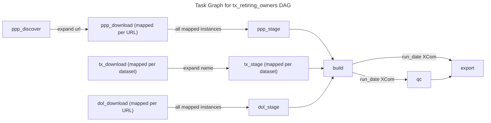
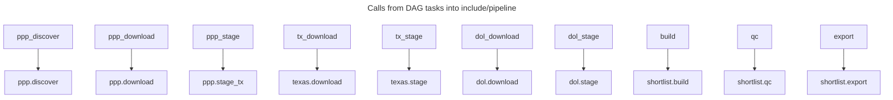

# C4 Code Level: dags

## Overview

- **Name**: Airflow DAG `tx_retiring_owners` (DAG definition package)
- **Description**: Single Airflow 3 DAG (Astro project) that orchestrates the daily download and staging of three public record sources (SBA PPP loans, Texas Comptroller datasets, DOL Form 5500 filings) and then builds, quality-checks and exports the retiring-owner shortlist. The DAG file contains only orchestration; the work is delegated to `include/pipeline`.
- **Location**: [`dags/`](../dags/) (files: [`dags/tx_retiring_owners.py`](../dags/tx_retiring_owners.py), [`dags/.airflowignore`](../dags/.airflowignore))
- **Language**: Python (Airflow SDK `airflow.sdk` decorators)
- **Purpose**: Define the task graph, per-task timeouts and concurrency limits, retry policy, and the ordering between source download/stage steps, the shortlist build, QC and export.

## Code Elements

### DAG

- `tx_retiring_owners()`: the DAG function, decorated with `@dag`, invoked at module level (last line of the file) so Airflow registers it.
  - Location: [`dags/tx_retiring_owners.py:9-19`](../dags/tx_retiring_owners.py#L9-L19) (decorator at 9, function at 19), module-level call at line 75
  - Signature: `def tx_retiring_owners() -> None`
  - Description: Builds the task graph described under Relationships. Takes no arguments.
  - Dependencies: `pendulum`, `datetime.timedelta`, `airflow.sdk.dag`, `airflow.sdk.task`, `include.pipeline` modules `dol`, `ppp`, `shortlist`, `texas`.

#### DAG parameters (from the `@dag` decorator)

| Parameter | Value | Notes |
| --- | --- | --- |
| `schedule` | `"@daily"` | Cron preset |
| `start_date` | `pendulum.datetime(2026, 10, 1, tz="UTC")` | |
| `catchup` | `False` | No backfill of missed intervals |
| `max_active_runs` | `1` | Only one run at a time |
| `is_paused_upon_creation` | `False` | Inline comment in source: a triggered run of a paused DAG stays queued forever |
| `tags` | `["texas"]` | |
| `default_args` | `{"retries": 2, "retry_delay": timedelta(minutes=5)}` | Applies to every task that does not override it; no task overrides retries |

No `params=` argument is set on the DAG. No `doc_md`, `description`, or `dag_id` override is set, so the DAG id is the function name `tx_retiring_owners`.

### Tasks

All tasks are defined as closures inside `tx_retiring_owners()`. Their `@task` arguments are shown; the default `@task` has no `execution_timeout`, `max_active_tis_per_dag`, or retry override beyond `default_args`.

#### `ppp_discover`

- Signature: `def ppp_discover() -> list[str]`
- Location: [`dags/tx_retiring_owners.py:20-22`](../dags/tx_retiring_owners.py#L20-L22) (decorator 20, def 21, body 22)
- Decorator: `@task` (no overrides)
- Description: Returns the list of PPP download URLs discovered by the PPP module.
- Calls: `include.pipeline.ppp.discover()` (called with no arguments; `data` defaults to `DATA`) ([`include/pipeline/ppp.py:61`](../include/pipeline/ppp.py#L61))
- Mapping: Output is the input of `ppp_download.expand(url=...)`. Its length is determined at runtime.

#### `ppp_download`

- Signature: `def ppp_download(url: str) -> bool`
- Location: [`dags/tx_retiring_owners.py:24-26`](../dags/tx_retiring_owners.py#L24-L26)
- Decorator: `@task(max_active_tis_per_dag=3, execution_timeout=timedelta(hours=2))`
- Description: Downloads one PPP file for the given URL. Dynamically mapped (one task instance per discovered URL).
- Calls: `include.pipeline.ppp.download(url)` (`data` defaults to `DATA`) ([`include/pipeline/ppp.py:82`](../include/pipeline/ppp.py#L82))
- Mapping: `ppp_download.expand(url=ppp_discover())`

#### `ppp_stage`

- Signature: `def ppp_stage() -> int`
- Location: [`dags/tx_retiring_owners.py:28-30`](../dags/tx_retiring_owners.py#L28-L30)
- Decorator: `@task(execution_timeout=timedelta(minutes=30))`
- Description: Stages the downloaded PPP data, keeping Texas rows; returns the staged count.
- Calls: `include.pipeline.ppp.stage_tx()` ([`include/pipeline/ppp.py:86`](../include/pipeline/ppp.py#L86)) (called with no arguments; signature defaults `data=DATA`, `min_rows=650_000`)
- Not mapped; called once.

#### `tx_download`

- Signature: `def tx_download(name: str) -> bool`
- Location: [`dags/tx_retiring_owners.py:32-34`](../dags/tx_retiring_owners.py#L32-L34)
- Decorator: `@task(execution_timeout=timedelta(hours=2))`
- Description: Downloads one Texas Comptroller dataset identified by its key in `texas.DATASETS`. Mapped over the dataset names.
- Calls: `include.pipeline.texas.download(name)` ([`include/pipeline/texas.py:89`](../include/pipeline/texas.py#L89))
- Mapping: `tx_download.expand(name=tx_names)` where `tx_names = list(texas.DATASETS)` (line 62). `texas.DATASETS` currently has keys `tx_franchise` and `tx_sales_outlets` ([`include/pipeline/texas.py:11`](../include/pipeline/texas.py#L11)), so this produces 2 mapped instances.

#### `tx_stage`

- Signature: `def tx_stage(name: str) -> int`
- Location: [`dags/tx_retiring_owners.py:36-38`](../dags/tx_retiring_owners.py#L36-L38)
- Decorator: `@task(execution_timeout=timedelta(minutes=30))`
- Description: Stages one Texas Comptroller dataset; returns the staged count.
- Calls: `include.pipeline.texas.stage(name)` ([`include/pipeline/texas.py:96`](../include/pipeline/texas.py#L96))
- Mapping: `tx_stage.expand(name=tx_names)` (line 63), same name list as `tx_download`.

#### `dol_download`

- Signature: `def dol_download(url: str) -> bool`
- Location: [`dags/tx_retiring_owners.py:40-42`](../dags/tx_retiring_owners.py#L40-L42)
- Decorator: `@task(max_active_tis_per_dag=2, execution_timeout=timedelta(hours=1))`
- Description: Downloads one DOL Form 5500 file for the given URL. Mapped over the generated URL list.
- Calls: `include.pipeline.dol.download(url)` ([`include/pipeline/dol.py:25`](../include/pipeline/dol.py#L25))
- Mapping: `dol_download.expand(url=dol_urls)` (line 67). `dol_urls` is built at parse time (line 65) as `[dol.url(form, year) for year in dol.YEARS for form in dol.FORMS]`. `dol.YEARS = (2022, 2023, 2024, 2025)` and `dol.FORMS = ("F_5500", "F_5500_SF")` ([`include/pipeline/dol.py:15-16`](../include/pipeline/dol.py#L15-L16)), giving 8 URLs and 8 mapped instances. URL builder: `include.pipeline.dol.url(form: str, year: int) -> str` ([`include/pipeline/dol.py:19`](../include/pipeline/dol.py#L19)).

#### `dol_stage`

- Signature: `def dol_stage() -> int`
- Location: [`dags/tx_retiring_owners.py:44-46`](../dags/tx_retiring_owners.py#L44-L46)
- Decorator: `@task(execution_timeout=timedelta(minutes=30))`
- Description: Stages the downloaded DOL Form 5500 data; returns the staged count.
- Calls: `include.pipeline.dol.stage()` (called with no arguments; signature defaults `data=DATA`, `min_rows=46_000`) ([`include/pipeline/dol.py:131`](../include/pipeline/dol.py#L131))
- Not mapped; called once (line 66).

#### `build`

- Signature: `def build() -> dict[str, object]`
- Location: [`dags/tx_retiring_owners.py:48-50`](../dags/tx_retiring_owners.py#L48-L50)
- Decorator: `@task(execution_timeout=timedelta(minutes=30))`
- Description: Builds the shortlist. Returns a dict; each key is published as its own XCom. The DAG reads `run_date` from it.
- Calls: `include.pipeline.shortlist.build()` (called with no arguments) ([`include/pipeline/shortlist.py:40`](../include/pipeline/shortlist.py#L40))
- Dependencies in the graph: runs after `ppp_stage`, `tx_stage` (all mapped instances) and `dol_stage` (line 71).

#### `qc`

- Signature: `def qc(run_date: str) -> None`
- Location: [`dags/tx_retiring_owners.py:52-54`](../dags/tx_retiring_owners.py#L52-L54)
- Decorator: `@task`
- Description: Runs quality checks on the shortlist built for `run_date`. Return value is `None`.
- Calls: `include.pipeline.shortlist.qc(run_date)` ([`include/pipeline/shortlist.py:78`](../include/pipeline/shortlist.py#L78), signature spans multiple lines and was not read in full)
- Invoked as `qc(built["run_date"])` (line 72). `run_date` is an XComArg from `build`'s returned dict.

#### `export`

- Signature: `def export(run_date: str) -> dict[str, int]`
- Location: [`dags/tx_retiring_owners.py:56-58`](../dags/tx_retiring_owners.py#L56-L58)
- Decorator: `@task`
- Description: Exports the shortlist for `run_date` and returns a dict of counts.
- Calls: `include.pipeline.shortlist.export(run_date)` (`data` defaults to `DATA`) ([`include/pipeline/shortlist.py:121`](../include/pipeline/shortlist.py#L121))
- Invoked as `export(built["run_date"])` (line 72), runs after `qc`.

### Module-level code

- `tx_retiring_owners()` is called at [`dags/tx_retiring_owners.py:75`](../dags/tx_retiring_owners.py#L75) to register the DAG.
- Parse-time computations (executed every time the DAG file is parsed): `tx_names` (line 62), `dol_urls` (line 65).

### Assets / Datasets

None. The DAG declares no `outlets`, `inlets`, or Asset/Dataset schedule. Scheduling is `@daily` only.

### Dynamic task mapping

| Task | Mapped over | Source of list | Instances |
| --- | --- | --- | --- |
| `ppp_download` | `url` | `ppp_discover()` output (runtime) | Unknown at parse time |
| `tx_download` | `name` | `list(texas.DATASETS)` (parse time) | 2 today |
| `tx_stage` | `name` | `list(texas.DATASETS)` (parse time) | 2 today |
| `dol_download` | `url` | `dol_urls` (parse time, 4 years x 2 forms) | 8 today |

`ppp_stage`, `dol_stage`, `build`, `qc`, `export` are not mapped.

### Concurrency and timeout settings

| Task | `max_active_tis_per_dag` | `execution_timeout` |
| --- | --- | --- |
| `ppp_discover` | default | default (none) |
| `ppp_download` | 3 | 2 hours |
| `ppp_stage` | default | 30 minutes |
| `tx_download` | default | 2 hours |
| `tx_stage` | default | 30 minutes |
| `dol_download` | 2 | 1 hour |
| `dol_stage` | default | 30 minutes |
| `build` | default | 30 minutes |
| `qc` | default | default (none) |
| `export` | default | default (none) |

All tasks inherit `retries=2` and `retry_delay=5 minutes` from `default_args`.

## Dependencies

### Internal Dependencies

- `include.pipeline.ppp`: `discover`, `download`, `stage_tx` ([`include/pipeline/ppp.py`](../include/pipeline/ppp.py))
- `include.pipeline.texas`: `DATASETS`, `download`, `stage` ([`include/pipeline/texas.py`](../include/pipeline/texas.py))
- `include.pipeline.dol`: `YEARS`, `FORMS`, `url`, `download`, `stage` ([`include/pipeline/dol.py`](../include/pipeline/dol.py))
- `include.pipeline.shortlist`: `build`, `qc`, `export` ([`include/pipeline/shortlist.py`](../include/pipeline/shortlist.py))
- Import style: `from include.pipeline import dol, ppp, shortlist, texas` (module-level, [`dags/tx_retiring_owners.py:6`](../dags/tx_retiring_owners.py#L6)). The DAG depends on `include/` as a package; `CLAUDE.md` states that `include/` never imports Airflow.

### External Dependencies

- `airflow.sdk` (Airflow 3 Task SDK): `dag`, `task` decorators
- `pendulum`: `pendulum.datetime` for `start_date`
- Python standard library: `datetime.timedelta`

### Configuration

- `.airflowignore` ([`dags/.airflowignore`](../dags/.airflowignore)) is empty: no files in `dags/` are ignored by the Airflow DAG processor.

## Relationships

Task graph as wired in the `tx_retiring_owners` function (lines 60-72). Solid arrows are the order set by `>>`. The bracketed fan-in at line 71 means `build` waits for all three stage tasks.

Module call graph into `include/pipeline`:

### Task dependency summary

| Upstream | Downstream | Mechanism |
| --- | --- | --- |
| `ppp_discover` | `ppp_download` | `expand(url=...)` |
| `ppp_download` (all) | `ppp_stage` | `>>` (line 61) |
| `tx_download` (all) | `tx_stage` | `>>` (line 64), both expanded over the same names |
| `dol_download` (all) | `dol_stage` | `>>` (line 67) |
| `ppp_stage`, `tx_stage` (all), `dol_stage` | `build` | `[...] >> built` (line 71) |
| `build` | `qc` | `built["run_date"]` XComArg (line 72) |
| `build` | `export` | `built["run_date"]` XComArg (line 72) |
| `qc` | `export` | `>>` (line 72) |

## Notes

- `build` returns a dict. `run_date` is passed to `qc` and `export` from the same XCom so a run that crosses midnight stays consistent (comment at lines 68-69).
- `dol_urls` and `tx_names` are computed at DAG parse time from `include/pipeline` constants. Changing `texas.DATASETS`, `dol.YEARS` or `dol.FORMS` changes the number of mapped instances on the next parse.
- `ppp_stage` is not mapped; it runs once after all `ppp_download` instances complete (the `>>` applies to the mapped task set).
- The `dol_stage` `min_rows` default (46,000) and `ppp.stage_tx` `min_rows` default (650,000) are set in `include/pipeline`, not in the DAG file.
- The `shortlist.qc` full signature (multi-line, starting at `include/pipeline/shortlist.py:78`) and the internals of the `include/pipeline` functions were not read, per scope. Only the call sites from the DAG were documented.
- `qc` and `export` take `run_date: str`, but `build` returns `dict[str, object]`; the type of the XCom value is not checked by the DAG.
