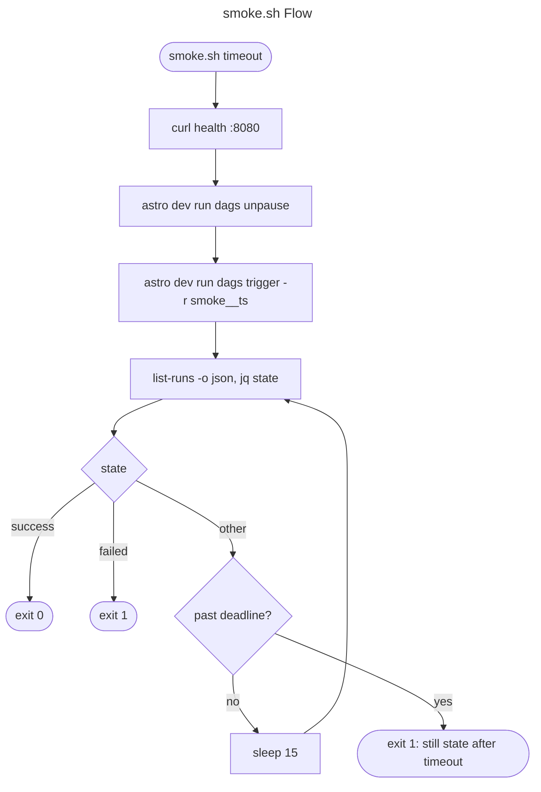

# C4 Code Level: scripts/

## Overview

- **Name**: Smoke test script (`smoke.sh`)
- **Description**: A single Bash script that triggers one run of the `tx_retiring_owners` Airflow DAG through the Astro CLI and polls until the run reaches a terminal state.
- **Location**: [scripts/](/home/pc/repos/RetiringBuinsinessOwners/scripts) (contains only [scripts/smoke.sh](/home/pc/repos/RetiringBuinsinessOwners/scripts/smoke.sh))
- **Language**: Bash (`#!/usr/bin/env bash`, `set -euo pipefail`)
- **Purpose**: End-to-end check against the running app. CLAUDE.md states "Nothing is done until the app has been run", and this script is the scripted version of that check: it needs a live Airflow at `localhost:8080`, not just the unit tests.
- **Usage**: `scripts/smoke.sh [timeout_seconds]` (default 600, per the comment on line 2 and the assignment on line 5)

## Code Elements

### Script Variables

| Name | Location | Value / Source | Purpose |
| --- | --- | --- | --- |
| `timeout` | [scripts/smoke.sh:5](/home/pc/repos/RetiringBuinsinessOwners/scripts/smoke.sh#L5) | `${1:-600}` | Max seconds to wait for the run to finish. |
| `dag` | [scripts/smoke.sh:6](/home/pc/repos/RetiringBuinsinessOwners/scripts/smoke.sh#L6) | `tx_retiring_owners` | DAG under test. |
| `run_id` | [scripts/smoke.sh:7](/home/pc/repos/RetiringBuinsinessOwners/scripts/smoke.sh#L7) | `smoke__$(date -u +%Y%m%dT%H%M%SZ)` | Unique run ID so repeated smoke runs do not collide. |
| `deadline` | [scripts/smoke.sh:13](/home/pc/repos/RetiringBuinsinessOwners/scripts/smoke.sh#L13) | `$((SECONDS + timeout))` | Bash `SECONDS`-based deadline for the poll loop. |
| `runs` | [scripts/smoke.sh:15](/home/pc/repos/RetiringBuinsinessOwners/scripts/smoke.sh#L15) | output of `astro dev run dags list-runs "$dag" -o json` | Raw CLI output, which may include Airflow warnings. |
| `state` | [scripts/smoke.sh:17](/home/pc/repos/RetiringBuinsinessOwners/scripts/smoke.sh#L17) | `jq` `.state` of the matching `run_id` | Current run state (for example `queued`, `running`, `success`, `failed`). |

### Steps (in order)

1. **Set shell options** ([L3](/home/pc/repos/RetiringBuinsinessOwners/scripts/smoke.sh#L3)): `set -euo pipefail`, so any failing command, unset variable, or pipeline failure stops the script.
2. **Parse the timeout** ([L5](/home/pc/repos/RetiringBuinsinessOwners/scripts/smoke.sh#L5)): first argument, default `600`.
3. **Build the run ID** ([L7](/home/pc/repos/RetiringBuinsinessOwners/scripts/smoke.sh#L7)): `smoke__` plus a UTC timestamp.
4. **Health check** ([L9](/home/pc/repos/RetiringBuinsinessOwners/scripts/smoke.sh#L9)): `curl -fsS http://localhost:8080/api/v2/monitor/health >/dev/null`. The `-f` flag makes an HTTP error fail the script. Output is discarded.
5. **Unpause the DAG** ([L10](/home/pc/repos/RetiringBuinsinessOwners/scripts/smoke.sh#L10)): `astro dev run dags unpause "$dag" >/dev/null`.
6. **Trigger the run** ([L11](/home/pc/repos/RetiringBuinsinessOwners/scripts/smoke.sh#L11)): `astro dev run dags trigger "$dag" -r "$run_id" >/dev/null`, using the generated run ID.
7. **Set the deadline** ([L13](/home/pc/repos/RetiringBuinsinessOwners/scripts/smoke.sh#L13)): `SECONDS + timeout`.
8. **Poll loop** ([L14-L27](/home/pc/repos/RetiringBuinsinessOwners/scripts/smoke.sh#L14)):
   - a. **List runs** ([L15](/home/pc/repos/RetiringBuinsinessOwners/scripts/smoke.sh#L15)): `astro dev run dags list-runs "$dag" -o json`. On failure it prints `list-runs failed: ...` to stderr and exits 1.
   - b. **Extract the state** ([L16-L18](/home/pc/repos/RetiringBuinsinessOwners/scripts/smoke.sh#L16)): keeps only lines beginning with `[` (the JSON array, since the CLI also prints warnings on stdout), then `jq -r --arg id "$run_id"` selects the matching `run_id` and prints its `.state`. If that fails, it prints `no JSON in list-runs output` to stderr and exits 1.
   - c. **Terminal states** ([L19-L22](/home/pc/repos/RetiringBuinsinessOwners/scripts/smoke.sh#L19)):
     - `success`: prints `<dag> <run_id>: success` to stdout and exits 0.
     - `failed`: prints `<dag> <run_id>: failed` to stderr and exits 1.
   - d. **Timeout** ([L23-L26](/home/pc/repos/RetiringBuinsinessOwners/scripts/smoke.sh#L23)): if the deadline has passed, prints `still '<state>' after <timeout>s` to stderr and exits 1.
   - e. **Wait** ([L27](/home/pc/repos/RetiringBuinsinessOwners/scripts/smoke.sh#L27)): `sleep 15` before the next poll.

Any other state (for example `queued` or `running`) falls through the `case` with no action and continues to the timeout check.

## What It Checks

- The Airflow API health endpoint responds successfully (step 4).
- The DAG accepts an unpause and a trigger with the generated run ID (steps 5 and 6). Errors here fail the script via `set -e`. Output is discarded, so the failure text comes from the CLI's own stderr.
- The run with that exact `run_id` reaches `success` within the timeout (step 8). `failed` and timeout are both exit 1.
- The JSON from `list-runs` is parseable, and a `list-runs` failure is reported with the raw output.

It does not check task-level results, the data written to `include/data/`, or the shortlist contents. Those are covered by the unit tests and by the CLAUDE.md query workflow.

## Dependencies

### Internal Dependencies

- None in the repository. The script does not source other scripts or import Python modules.
- It relies on the DAG `tx_retiring_owners` defined under `dags/` (not in this directory).

### External Dependencies

- **Bash**: `set -euo pipefail`, `${1:-600}`, `$SECONDS`, `$(date -u ...)`, here-strings (`<<<`).
- **curl**: health check against `http://localhost:8080/api/v2/monitor/health`.
- **Astro CLI (`astro`)**: `astro dev run dags unpause`, `astro dev run dags trigger`, and `astro dev run dags list-runs -o json`. It runs the Airflow CLI inside the local Astro dev containers, so `astro dev start` must be running.
- **jq**: parses the `list-runs` JSON.
- **grep**: keeps only the JSON line from mixed CLI output.
- **date** (GNU or BSD): generates the UTC timestamp for `run_id`.
- **sleep**: 15-second poll interval.
- **Running Airflow**: the API must be reachable on port 8080. The CLAUDE.md "Run" section describes `astro dev start` as the way to bring it up.

## Relationships

## Notes

- The script exits 1 on every failure path, and every failure path writes a message. There are no fallback defaults that hide failures, which matches the CLAUDE.md rule against swallowed exceptions.
- Output from `unpause` and `trigger` is discarded with `>/dev/null`. A failure in those steps still stops the script, but the CLI's error text is not captured by the script itself.
- The `sleep 15` is a poll interval, not a fix for a race. The state check is re-run on each iteration until the run reaches a terminal state or the deadline passes.
- The `grep '^\['` filter depends on the JSON array starting at the beginning of a line. If the Astro CLI changes its output format, the `no JSON in list-runs output` branch is the failure path.
- Running `smoke.sh` requires the Astro dev stack. CLAUDE.md's task-log command selects this repository's scheduler by working-directory label, which is separate from this script.
