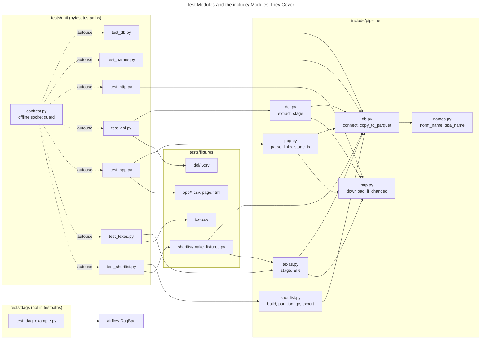

# C4 Code Level: tests/

## Overview

- **Name**: Test suite (unit tests, DAG import test, fixtures)
- **Description**: Offline pytest suite for the `include/pipeline` modules (DuckDB staging, HTTP download caching, PPP/TX/DOL parsing, shortlist build/export/QC), plus an Airflow DagBag test template and the fixture data those tests read.
- **Location**: [tests/](/home/pc/repos/RetiringBuinsinessOwners/tests)
- **Language**: Python 3 (type-annotated), SQL executed through DuckDB, CSV/HTML/Parquet fixtures
- **Purpose**: Verify pipeline logic on the host without Airflow and without network access. `pyproject.toml` sets `testpaths = ["tests/unit"]` and `pythonpath = ["."]`, so `mise` runs `uv run pytest tests/unit -q`. `tests/dags/` is outside `testpaths` and is excluded from ruff in `pyproject.toml`, so it runs only when named explicitly.

## Code Elements

### Test Modules

#### tests/unit/test_db.py

Covers `include.pipeline.db` (`connect`, `copy_to_parquet`).

- `test_writes_rows_and_leaves_no_part_file(tmp_path: Path) -> None`
  - Description: `copy_to_parquet` writes 3 rows from `range(3)` to `stage/x.parquet`, returns `3`, and leaves no temporary part file in the directory.
  - Location: [tests/unit/test_db.py:9](/home/pc/repos/RetiringBuinsinessOwners/tests/unit/test_db.py#L9)
  - Dependencies: `duckdb`, `include.pipeline.db.connect`, `include.pipeline.db.copy_to_parquet`
- `test_failing_query_keeps_previous_file(tmp_path: Path) -> None`
  - Description: A query that raises `error('boom')` partway through a 1,000,000-row scan raises `duckdb.InvalidInputException`, leaves the previous parquet file byte-identical, and creates no extra files.
  - Location: [tests/unit/test_db.py:23](/home/pc/repos/RetiringBuinsinessOwners/tests/unit/test_db.py#L23)
  - Dependencies: `duckdb`, `pytest.raises`, `copy_to_parquet`
- `test_params_are_bound(tmp_path: Path) -> None`
  - Description: Positional parameters `[7, "it's"]` are bound (including a quote character) and round-trip through the written parquet file as `(7, "it's")`.
  - Location: [tests/unit/test_db.py:40](/home/pc/repos/RetiringBuinsinessOwners/tests/unit/test_db.py#L40)
  - Dependencies: `duckdb`, `copy_to_parquet`

#### tests/unit/test_names.py

Covers the DuckDB name macros `norm_name` and `dba_name` registered by `include.pipeline.db.connect`.

- `CASES` (module-level list, [tests/unit/test_names.py:5](/home/pc/repos/RetiringBuinsinessOwners/tests/unit/test_names.py#L5))
  - Description: 14 `(name, norm, dba)` tuples. Ten come from the spec table; four (`&AMP;`, `&#39;`, `&#8211;`, and two `DBA` prefix cases) are real SBA name shapes, per the inline comment.
- `test_name_macros(name: str, norm: str | None, dba: str | None) -> None`
  - Description: Parametrized over `CASES`. Runs `select norm_name($1), dba_name($1)` and asserts the row equals `[(norm, dba)]`. Covers punctuation stripping, legal suffixes (INC, LLC, CO, "L.L.C."), `&`/`AND` handling, HTML entity decoding, hyphen handling, and DBA splitting. Empty and suffix-only names return `None`.
  - Location: [tests/unit/test_names.py:29](/home/pc/repos/RetiringBuinsinessOwners/tests/unit/test_names.py#L29)
  - Dependencies: `pytest.mark.parametrize`, `include.pipeline.db.connect`

#### tests/unit/test_http.py

Covers `include.pipeline.http.download_if_changed` against a local HTTP server.

- `class Handler(BaseHTTPRequestHandler)`
  - Description: Test server handler with class-level state: `body`, `etag` (default `'"v1"'`), `truncate` (sends only the first 3 bytes of the body when true), and `gets` (GET counter). Sends `ETag` and `Content-Length` on both HEAD and GET.
  - Location: [tests/unit/test_http.py:13](/home/pc/repos/RetiringBuinsinessOwners/tests/unit/test_http.py#L13)
  - Methods:
    - `do_HEAD(self) -> None` ([L19](/home/pc/repos/RetiringBuinsinessOwners/tests/unit/test_http.py#L19)): calls `send_headers`.
    - `do_GET(self) -> None` ([L22](/home/pc/repos/RetiringBuinsinessOwners/tests/unit/test_http.py#L22)): increments `Handler.gets`, sends headers, writes the body (or a truncated slice).
    - `send_headers(self) -> None` ([L27](/home/pc/repos/RetiringBuinsinessOwners/tests/unit/test_http.py#L27)): 200 response with `ETag` and `Content-Length`.
    - `log_message(self, format: str, *args: object) -> None` ([L33](/home/pc/repos/RetiringBuinsinessOwners/tests/unit/test_http.py#L33)): no-op to silence logging.
- `url() -> Iterator[str]` (pytest fixture, [tests/unit/test_http.py:37](/home/pc/repos/RetiringBuinsinessOwners/tests/unit/test_http.py#L37))
  - Description: Resets `Handler` state, starts a `ThreadingHTTPServer` on `127.0.0.1:0` in a daemon thread, yields `http://127.0.0.1:<port>/loans.csv`, then shuts the server down.
  - Dependencies: `http.server`, `threading`
- `test_first_call_downloads(url: str, tmp_path: Path) -> None`
  - Description: First call returns `True`, writes the 8-byte body, and writes `loans.csv.meta.json` with `url`, `etag` `"v1"`, and `bytes` 8. Exactly one GET.
  - Location: [tests/unit/test_http.py:52](/home/pc/repos/RetiringBuinsinessOwners/tests/unit/test_http.py#L52)
- `test_unchanged_etag_sends_no_get(url: str, tmp_path: Path) -> None`
  - Description: Second call with an unchanged ETag returns `False` and sends no additional GET (`gets == 1`).
  - Location: [tests/unit/test_http.py:63](/home/pc/repos/RetiringBuinsinessOwners/tests/unit/test_http.py#L63)
- `test_changed_etag_downloads_again(url: str, tmp_path: Path) -> None`
  - Description: Changing the server ETag to `"v2"` and the body to 3 rows makes the next call return `True`, rewrite the file, and issue a second GET.
  - Location: [tests/unit/test_http.py:72](/home/pc/repos/RetiringBuinsinessOwners/tests/unit/test_http.py#L72)
- `test_truncated_body_raises_and_keeps_previous_file(url: str, tmp_path: Path) -> None`
  - Description: A truncated response raises `requests.exceptions.ChunkedEncodingError`; the previous file and its metadata (`etag` `"v1"`) are kept, and no temporary file is left behind.
  - Location: [tests/unit/test_http.py:83](/home/pc/repos/RetiringBuinsinessOwners/tests/unit/test_http.py#L83)
- `test_damaged_local_file_downloads_again(url: str, tmp_path: Path) -> None`
  - Description: A local file overwritten with `a,b\n` (damaged) is replaced by a fresh download even though the ETag is unchanged (returns `True`, `gets == 2`).
  - Location: [tests/unit/test_http.py:102](/home/pc/repos/RetiringBuinsinessOwners/tests/unit/test_http.py#L102)

#### tests/unit/test_dol.py

Covers `include.pipeline.dol` (`extract`, `stage`).

- `FIXTURES` (module constant, [tests/unit/test_dol.py:10](/home/pc/repos/RetiringBuinsinessOwners/tests/unit/test_dol.py#L10)): `tests/fixtures/dol`.
- `zip_fixture(raw: Path, form: str) -> None` (helper, [tests/unit/test_dol.py:13](/home/pc/repos/RetiringBuinsinessOwners/tests/unit/test_dol.py#L13))
  - Description: Builds `raw/<form>_2024_Latest.zip` containing the matching `<form>_2024_latest.csv` fixture and a `*_layout.txt` stub.
- `test_stage_keeps_latest_texas_filing_per_ein(tmp_path: Path) -> None`
  - Description: Stages both zips with `min_rows=1` and asserts `stage` returns `3`. The output parquet has one row per EIN with signer, plan age, `form`, `form_year`, ZIP5, and participant counts. Two rows for EIN 750289970 collapse to the later-received filing (pension plan, `DATE_RECEIVED` 2025-07-15 over 2025-06-01).
  - Location: [tests/unit/test_dol.py:20](/home/pc/repos/RetiringBuinsinessOwners/tests/unit/test_dol.py#L20)
  - Dependencies: `zipfile`, `duckdb`, `include.pipeline.dol.stage`
- `test_extract_raises_on_two_csvs(tmp_path: Path) -> None`
  - Description: A zip with two CSV members raises `ValueError` matching `expected exactly one CSV`.
  - Location: [tests/unit/test_dol.py:45](/home/pc/repos/RetiringBuinsinessOwners/tests/unit/test_dol.py#L45)
  - Dependencies: `include.pipeline.dol.extract`

#### tests/unit/test_ppp.py

Covers `include.pipeline.ppp` (`parse_links`, `stage_tx`).

- `FIXTURES`, `BASE` (module constants, [tests/unit/test_ppp.py:9-10](/home/pc/repos/RetiringBuinsinessOwners/tests/unit/test_ppp.py#L9)): `tests/fixtures/ppp` and the SBA distribution URL prefix.
- `test_stage_tx_keeps_texas_loans_typed(tmp_path: Path) -> None`
  - Description: Copies all `*.csv` PPP fixtures into `raw/ppp`, runs `stage_tx(min_rows=1)`, asserts `4` rows. The output has typed columns (`date_approved` as DATE, `jobs_reported`, `nonprofit` boolean), name macros applied (`ROBERT GARZA` with DBA `COOL AIR`), and NAICS nulls preserved.
  - Location: [tests/unit/test_ppp.py:13](/home/pc/repos/RetiringBuinsinessOwners/tests/unit/test_ppp.py#L13)
  - Dependencies: `shutil`, `duckdb`, `include.pipeline.ppp.stage_tx`
- `test_parse_links_returns_the_13_files_sorted() -> None`
  - Description: `parse_links` on `page.html` returns exactly 13 CSV URLs (the 150k-plus file first, then `public_up_to_150k_1..12`, sorted as the test expects). The xlsx data dictionary link is not returned.
  - Location: [tests/unit/test_ppp.py:38](/home/pc/repos/RetiringBuinsinessOwners/tests/unit/test_ppp.py#L38)
- `test_parse_links_raises_on_too_few_links() -> None`
  - Description: Two links raise `ValueError` with `2 PPP CSV links, expected at least 13`.
  - Location: [tests/unit/test_ppp.py:48](/home/pc/repos/RetiringBuinsinessOwners/tests/unit/test_ppp.py#L48)
- `test_parse_links_raises_on_two_releases_of_one_file() -> None`
  - Description: Adding `public_up_to_150k_1_250331.csv` (a second release of file 1) raises `ValueError` with `a file appears in two releases`.
  - Location: [tests/unit/test_ppp.py:57](/home/pc/repos/RetiringBuinsinessOwners/tests/unit/test_ppp.py#L57)

#### tests/unit/test_texas.py

Covers `include.pipeline.texas` (`stage`, EIN derivation, header and date validation).

- `FIXTURES` (module constant, [tests/unit/test_texas.py:10](/home/pc/repos/RetiringBuinsinessOwners/tests/unit/test_texas.py#L10)): `tests/fixtures/tx`.
- `raw_dir(tmp_path: Path) -> Path` (helper, [tests/unit/test_texas.py:13](/home/pc/repos/RetiringBuinsinessOwners/tests/unit/test_texas.py#L13))
  - Description: Creates and returns `tmp_path/raw/tx`.
- `test_stage_derives_ein_dates_and_names(tmp_path: Path) -> None`
  - Description: Stages `tx_franchise` (expects 4 rows) and `tx_sales_outlets` (expects 5 rows). Asserts the derived `ein` (taxpayer numbers starting with `1` yield digits 2–10; others, including `3…` and `1…` numbers with a non-`1` prefix, yield null), typed dates (`charter_date`, `permit_issue_date`, `first_sales_date`, with blank and `12/31/1938`-style values), and normalized names (the `LANKMARK` misspelling is kept in `norm_outlet_name`).
  - Location: [tests/unit/test_texas.py:19](/home/pc/repos/RetiringBuinsinessOwners/tests/unit/test_texas.py#L19)
  - Dependencies: `shutil`, `duckdb`, `include.pipeline.texas.stage`
- `test_renamed_header_raises(tmp_path: Path) -> None`
  - Description: A franchise file whose header differs (`SOS Status Date` without the trailing space) raises `ValueError` matching `header changed`.
  - Location: [tests/unit/test_texas.py:63](/home/pc/repos/RetiringBuinsinessOwners/tests/unit/test_texas.py#L63)
- `test_malformed_date_raises(tmp_path: Path) -> None`
  - Description: A `31/12/1938` charter date raises `duckdb.InvalidInputException` matching `31/12/1938`, and no `stage/tx_franchise.parquet` is written.
  - Location: [tests/unit/test_texas.py:73](/home/pc/repos/RetiringBuinsinessOwners/tests/unit/test_texas.py#L73)

#### tests/unit/test_shortlist.py

Covers `include.pipeline.shortlist` (`build`, `partition`, `qc`, `export`), using stage files produced by `write_stage` from `make_fixtures.py`.

- `test_build_matches_in_tiers_and_shortlists_old_businesses(tmp_path: Path) -> None`
  - Description: `build(tmp_path, date(2026, 10, 17))` returns counts (`ppp_businesses` 19, `matched` 15, `tier_1` 10, `tier_2` 1, `tier_3` 2, `tier_4` 2, `shortlisted` 9). The partition contains 9 expected rows with `match_tier`, `years_in_business`, `age_source`, `plan_signer_name`, and `org_type`. A NAICS title check covers a three-digit fallback for a retired 6-digit code. Then runs `qc("2026-10-17", tmp_path, min_rows=1)`.
  - Location: [tests/unit/test_shortlist.py:12](/home/pc/repos/RetiringBuinsinessOwners/tests/unit/test_shortlist.py#L12)
  - Dependencies: `duckdb`, `write_stage`, `include.pipeline.shortlist.build/partition/qc`
- `test_export_writes_rows_new_since_the_previous_run(tmp_path: Path) -> None`
  - Description: Build for 2026-10-16, then `export` returns `{"latest": 8, "new_since_previous": 8}`. After a 2026-10-17 build, export returns `{"latest": 9, "new_since_previous": 1}`, and `marts/shortlist_new_since_previous.csv` holds only `17513131313` (OSCAR GLASS, 30 years).
  - Location: [tests/unit/test_shortlist.py:64](/home/pc/repos/RetiringBuinsinessOwners/tests/unit/test_shortlist.py#L64)
  - Dependencies: `csv`, `include.pipeline.shortlist.export`
- `test_export_skips_unexported_runs_and_never_goes_back(tmp_path: Path) -> None`
  - Description: The 2026-10-16 run is never exported (described as a failed QC). Exporting 2026-10-17 reports all 9 as new. Exporting 2026-10-16 afterwards raises `ValueError` matching `run_date=2026-10-17 is already exported`.
  - Location: [tests/unit/test_shortlist.py:79](/home/pc/repos/RetiringBuinsinessOwners/tests/unit/test_shortlist.py#L79)
- `test_qc_raises_on_a_repeated_taxpayer_number(tmp_path: Path) -> None`
  - Description: Rewrites the partition with one row duplicated, then `qc` raises `AssertionError` matching `1 repeated taxpayer numbers`.
  - Location: [tests/unit/test_shortlist.py:90](/home/pc/repos/RetiringBuinsinessOwners/tests/unit/test_shortlist.py#L90)

#### tests/dags/test_dag_example.py

Airflow DagBag template test (not in `testpaths`; excluded from ruff). Imports `airflow.models.DagBag`.

- `suppress_logging(namespace)` ([L11](/home/pc/repos/RetiringBuinsinessOwners/tests/dags/test_dag_example.py#L11), `@contextmanager`): disables the named logger in a try/finally.
- `get_import_errors()` ([L21](/home/pc/repos/RetiringBuinsinessOwners/tests/dags/test_dag_example.py#L21)): returns `[(None, None)]` plus `(relpath, message)` for each DagBag import error. Note the `strip_path_prefix` helper calls `os.path.relpath(path, os.environ.get("AIRFLOW_HOME"))`, so `AIRFLOW_HOME` must be set.
- `get_dags()` ([L37](/home/pc/repos/RetiringBuinsinessOwners/tests/dags/test_dag_example.py#L37)): returns `(dag_id, dag, relpath)` for each DAG in the DagBag.
- `test_file_imports(rel_path, rv)` ([L53](/home/pc/repos/RetiringBuinsinessOwners/tests/dags/test_dag_example.py#L53)): raises if an import error exists (the `(None, None)` placeholder passes).
- `APPROVED_TAGS = {}` ([L59](/home/pc/repos/RetiringBuinsinessOwners/tests/dags/test_dag_example.py#L59)): empty, so the approved-tag check is skipped.
- `test_dag_tags(dag_id, dag, fileloc)` ([L65](/home/pc/repos/RetiringBuinsinessOwners/tests/dags/test_dag_example.py#L65)): asserts each DAG has at least one tag.
- `test_dag_retries(dag_id, dag, fileloc)` ([L77](/home/pc/repos/RetiringBuinsinessOwners/tests/dags/test_dag_example.py#L77)): asserts `dag.default_args.get("retries", None) >= 2`. If `retries` is absent, `None >= 2` raises `TypeError` rather than a clean assertion.

### Fixtures and Helpers

#### tests/unit/conftest.py

- `offline(monkeypatch: pytest.MonkeyPatch) -> None` (autouse fixture, [tests/unit/conftest.py:7](/home/pc/repos/RetiringBuinsinessOwners/tests/unit/conftest.py#L7))
  - Description: Replaces `socket.socket.connect` with a guard that raises `RuntimeError("unit tests are offline: refused ...")` for any address other than `127.0.0.1`. Applies to every unit test. The local `Handler` server in `test_http.py` is the only permitted connection.
  - Dependencies: `socket`, `pytest.MonkeyPatch`
- `guarded(self: socket.socket, address: object) -> None` (inner function, [tests/unit/conftest.py:11](/home/pc/repos/RetiringBuinsinessOwners/tests/unit/conftest.py#L11))
  - Description: The replacement `connect`. Checks `address[0] == "127.0.0.1"` and delegates to the original.

#### tests/fixtures/shortlist/make_fixtures.py

Module docstring: tiny stage files for `test_shortlist.py`, one PPP business per case in spec 04, years counted to 2026-10-17, norm names from the real macros. Imports `connect` from `include.pipeline.db` and `EIN` from `include.pipeline.texas`.

- `PPP` (module constant, [L15](/home/pc/repos/RetiringBuinsinessOwners/tests/fixtures/shortlist/make_fixtures.py#L15))
  - Description: 19 tuples `(borrower_name, address, city, zip5, naics, business_type, nonprofit, loan_status, jobs, approved_amount)`. Each has a comment naming the case it covers: tier 1 exact match, tier 2 ZIP mismatch, tier 3 misspelling, PO-box near-match pairs, tier 4 DBA sole-proprietor, ambiguous name, no registration, nonprofit, charged off, 10-year-old, duplicate name variants, pension-dated age, placeholder plan date, excluded corporation tier-4 outlet, retired NAICS code, unflagged church.
- `FRANCHISE` (module constant, [L75](/home/pc/repos/RetiringBuinsinessOwners/tests/fixtures/shortlist/make_fixtures.py#L75))
  - Description: 15 tuples `(taxpayer_number, name, address, city, zip5, org_type, charter_date)` representing `tx_franchise` rows. Names and addresses are deliberately near-matches (for example `CHARLIE ROOFING CO` vs `CHARLIE ROOFNG CO`).
- `OUTLETS` (module constant, [L111](/home/pc/repos/RetiringBuinsinessOwners/tests/fixtures/shortlist/make_fixtures.py#L111))
  - Description: 3 tuples `(taxpayer_number, org_type, outlet_name, outlet_zip5, naics, first_sales_date)` for `tx_sales_outlets`.
- `DOL` (module constant, [L126](/home/pc/repos/RetiringBuinsinessOwners/tests/fixtures/shortlist/make_fixtures.py#L126))
  - Description: 3 tuples `(ein, earliest_plan_eff_date, signer_name, signer_source, plan_name, pension_codes, ever_defined_benefit)`. The third has a 1900-01-01 placeholder date and no signer.
- `write(con: duckdb.DuckDBPyConnection, dest: Path, columns: str, rows: Sequence[tuple[object, ...]], derived: str) -> None` ([L138](/home/pc/repos/RetiringBuinsinessOwners/tests/fixtures/shortlist/make_fixtures.py#L138))
  - Description: Creates temp table `t` with `columns`, inserts `rows` with `executemany`, and writes `select *, <derived> from t` to a parquet file at `dest`.
  - Dependencies: `duckdb`
- `write_stage(data: Path) -> None` ([L150](/home/pc/repos/RetiringBuinsinessOwners/tests/fixtures/shortlist/make_fixtures.py#L150))
  - Description: Creates `data/stage/` and writes four parquet files: `ppp_tx.parquet` (adds `norm_name`, `dba_norm_name`, `county`, `business_age_description`, `date_approved` 2020-05-01, `loan_number`), `tx_franchise.parquet` (adds `ein` via `EIN`, `norm_name`, `right_to_transact` 'A', `sos_file_number`, null `naics`), `tx_sales_outlets.parquet` (adds `ein`, `norm_outlet_name`, `outlet_number` '1'), and `dol_5500_tx.parquet` (adds `phone`, `active_participants` 10, `date_received` 2025-07-01, `business_code` '238220'). Imported by `test_shortlist.py`.
  - Dependencies: `include.pipeline.db.connect`, `include.pipeline.texas.EIN`

**Note on make_fixtures.py**: it is a fixture module in `tests/fixtures/shortlist/`, not a test. It has no `__init__.py`, so `tests/unit/test_shortlist.py` imports it as the namespace package `tests.fixtures.shortlist.make_fixtures`. Its `__pycache__` contains a CPython 3.14 bytecode file.

### Data Fixture Files

| File | Used by | Contents and what it exercises |
| --- | --- | --- |
| `tests/fixtures/dol/f_5500_2024_latest.csv` | `test_dol.py` (zipped as `F_5500_2024_Latest.zip`) | Header plus 2 data rows, both for EIN 750289970 (Texas Instruments plans). Exercises keep-latest-per-EIN (`DATE_RECEIVED` 2025-07-15 vs 2025-06-01), signer from `ADMIN_SIGNED_NAME`, and defined-benefit flags from `TYPE_PENSION_BNFT_CODE` (`1A1I3H` vs `2E2J2K2F2G2T3H`). |
| `tests/fixtures/dol/f_5500_sf_2024_latest.csv` | `test_dol.py` (zipped as `F_5500_SF_2024_Latest.zip`) | Header plus 3 data rows: a Texas sponsor (EIN 470871940, signer "DWAYNE GARRETT"), a Texas sponsor with no signer (EIN 760123456), and a California sponsor (EIN 814786801) that the expected output excludes. |
| `tests/fixtures/ppp/public_150k_plus_240930.csv` | `test_ppp.py` | Header plus 3 SBA PPP rows (one Texas, two other states). Only the Texas row is expected from the staged output. |
| `tests/fixtures/ppp/public_up_to_150k_1_240930.csv` | `test_ppp.py` | Header plus 4 SBA PPP rows. Texas rows include a sole proprietor with a DBA (`ROBERT GARZA D/B/A COOL AIR`), a nonprofit church flagged `Y`, and a `Exemption 4` loan with a comma-and-period name. Other-state rows are excluded. |
| `tests/fixtures/ppp/page.html` | `test_ppp.py` (`parse_links`) | Trimmed SBA "Data and resources" page: 14 `<a href>` links, of which 13 are distinct `public_*.csv` files (`150k_plus` plus `up_to_150k_1`..`12`) and one is the xlsx data dictionary. |
| `tests/fixtures/tx/tx_franchise.csv` | `test_texas.py` | Header plus 6 Comptroller franchise rows, including a Connecticut-address row with padded whitespace and a `X` record type. The test expects 4 staged rows. Covers EIN derivation, mixed date formats, and blank SOS fields. |
| `tests/fixtures/tx/tx_franchise_bad_date.csv` | `test_texas.py` (`test_malformed_date_raises`) | Same shape as `tx_franchise.csv`, with the first row's `SOS Charter Date` set to `31/12/1938` (not `MM/DD/YYYY`). |
| `tests/fixtures/tx/tx_franchise_renamed_header.csv` | `test_texas.py` (`test_renamed_header_raises`) | Same data as `tx_franchise.csv`, with the header's `SOS Status Date ` (trailing space) changed to `SOS Status Date`. |
| `tests/fixtures/tx/tx_sales_outlets.csv` | `test_texas.py` | Header plus 5 sales-tax outlet rows, including a `LANKMARK` misspelling of a taxpayer name, a permit date that is blank for one outlet, and a first-sales date that precedes the permit date. Test expects 5 staged rows. |

### Mermaid: Test-to-Module Coverage

## Dependencies

### Internal Dependencies

- `include.pipeline.db`: `connect`, `copy_to_parquet`. Used by `test_db.py`, `test_names.py`, `make_fixtures.py`.
- `include.pipeline.names`: `NAME_MACROS` (loaded by `db.connect`). Exercised via `test_names.py`.
- `include.pipeline.http`: `download_if_changed`, `HEADERS`, `TIMEOUT`. Exercised by `test_http.py`.
- `include.pipeline.dol`: `extract`, `stage`. Used by `test_dol.py`.
- `include.pipeline.ppp`: `parse_links`, `stage_tx`. Used by `test_ppp.py`.
- `include.pipeline.texas`: `stage`, `EIN`. Used by `test_texas.py` and `make_fixtures.py`.
- `include.pipeline.shortlist`: `build`, `partition`, `qc`, `export`. Used by `test_shortlist.py`.
- `include.pipeline.paths`: `DATA` (default data directory; the tests pass `tmp_path` explicitly).
- `tests.fixtures.shortlist.make_fixtures`: `write_stage`, imported by `test_shortlist.py`.

### External Dependencies

- **pytest** (dev group in `pyproject.toml`): fixtures (`tmp_path`, `monkeypatch`), `pytest.raises`, `pytest.mark.parametrize`.
- **duckdb==1.5.6** (runtime dependency in `pyproject.toml`): every staging test and `make_fixtures.py`.
- **requests==2.34.2** (runtime dependency): `test_http.py` imports it for the `ChunkedEncodingError` assertion.
- **Python standard library**: `socket`, `zipfile`, `csv`, `shutil`, `threading`, `http.server`, `json`, `datetime`, `pathlib`.
- **types-requests** (dev group): type stubs for mypy strict, which covers `tests/unit` as well as `include`.
- **apache-airflow** (imported by `tests/dags/test_dag_example.py`): `airflow.models.DagBag`. It is not listed in `pyproject.toml`'s dependency groups, so that test needs an Airflow install in the environment where it runs.

## Relationships

The Mermaid diagram above shows which test module covers which include module. The tests use DuckDB as an in-process database and `tmp_path` for all file output, so the suite does not share state between tests.

## Notes

- `tests/unit` runs offline by design: `conftest.py` blocks every non-loopback socket connect. Any test that needs the network would fail at connect time.
- Most tests read back parquet files with DuckDB, so they depend on the DuckDB version pinned in `pyproject.toml` (`duckdb==1.5.6`).
- Several tests assert exact row content and counts from fixtures (for example `test_stage_tx_keeps_texas_loans_typed` expects 4 rows, `test_build_matches_in_tiers_and_shortlists_old_businesses` expects 19 PPP businesses). Changing a fixture requires updating those expectations.
- The `tests/dags/test_dag_example.py` file is the stock Astro template test; its own docstring says it is an example. `pyproject.toml` excludes it from ruff (`extend-exclude`) and from pytest `testpaths`.
- The `__pycache__` directories under `tests/` contain CPython 3.14 bytecode and are not source.
