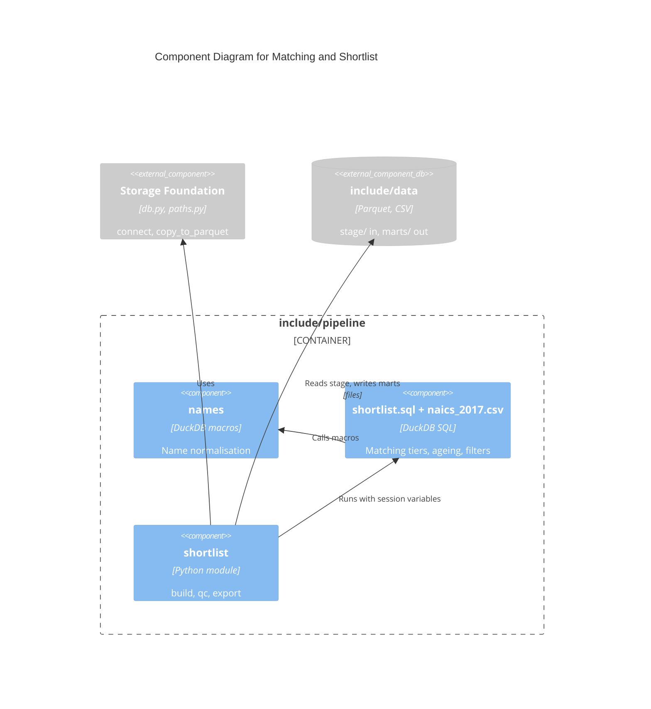

# C4 Component Level: Matching and Shortlist

## Overview

- **Name**: Matching and Shortlist
- **Description**: Normalises business names, matches PPP borrowers to Texas registrations, builds the shortlist, runs QC and exports CSVs.
- **Type**: Library (Python modules plus DuckDB SQL)
- **Technology**: Python, DuckDB SQL (`sql/shortlist.sql`, `NAME_MACROS`), CSV data asset

## Purpose

Turns the four staged Parquet files into `marts/matches.parquet`, a dated shortlist partition of long-established businesses (`MIN_YEARS = 30`, `EXCLUDED_NAICS` removed, titles from `naics_2017.csv`), and two CSV exports for the owner.

## Software Features

- Name macros (`names.NAME_MACROS`): `name_unescape`, `name_clean`, `name_finish`, `norm_name`, `dba_name` handle HTML entities, punctuation, leading THE, trailing entity words and DBA names.
- Matching in `sql/shortlist.sql`, driven by DuckDB session variables (`ppp`, `franchise`, `outlets`, `dol`, `run_date`, `min_years`, `excluded_naics`, `naics_titles`); `match_tier` values 1 to 4.
- `build` writes `matches.parquet` and `marts/shortlist/run_date=<date>/shortlist.parquet`; returns counts (`ppp_businesses`, `matched`, `tier_1..4`, `shortlisted`).
- `qc` asserts: matched share of non-individual PPP businesses >= 30%, >= 100 shortlist rows, unique taxpayer numbers, none under 30 years, every row has an `age_source`, no nonprofit or charged-off rows. Each message names the file and the numbers.
- `export` writes `shortlist_latest.csv` and `shortlist_new_since_previous.csv` (anti join to the last exported partition), then touches `_exported`; raises if a later run_date is already exported.

## Code Elements

- [c4-code-include-pipeline.md](./c4-code-include-pipeline.md) - modules:
  - `names.py` - DuckDB name macros.
  - `sql/shortlist.sql` - matching and shortlist SQL.
  - `shortlist.py` - `build`, `qc`, `export`, `partition`.
  - `naics_2017.csv` - NAICS title lookup.

## Interfaces

### Python functions (called by Pipeline Orchestration)

- **Protocol**: in-process Python call; files (Parquet in, Parquet and CSV out)
- **Operations**:
  - `shortlist.build(data: Path = DATA, run_date: date | None = None) -> dict[str, object]`
  - `shortlist.qc(run_date: str, data: Path = DATA, min_match_share: float = 0.30, min_rows: int = 100) -> None` - raises AssertionError.
  - `shortlist.export(run_date: str, data: Path = DATA) -> dict[str, int]`
  - `shortlist.partition(data: Path, run_date: str) -> Path`
  - `names.NAME_MACROS: str` - registered by Storage Foundation's `connect()` and used by Source Ingestion SQL (`norm_name`).

### File outputs

- `include/data/marts/matches.parquet`, `marts/shortlist/run_date=<date>/shortlist.parquet`, `marts/shortlist_latest.csv`, `marts/shortlist_new_since_previous.csv`.

## Dependencies

### Components Used

- Storage Foundation: `connect`, `copy_to_parquet`, `DATA`.
- Source Ingestion: reads its `stage/*.parquet` outputs (file coupling only, no import).

### External Systems

- Local `include/data` filesystem. No network access.

## Verification: tests are not a runtime component. [c4-code-tests.md](./c4-code-tests.md) covers `tests/unit/` and `tests/dags/`; `scripts/smoke.sh` ([c4-code-scripts.md](./c4-code-scripts.md)) triggers one full `tx_retiring_owners` run against the running Astro app.

## Component Diagram

