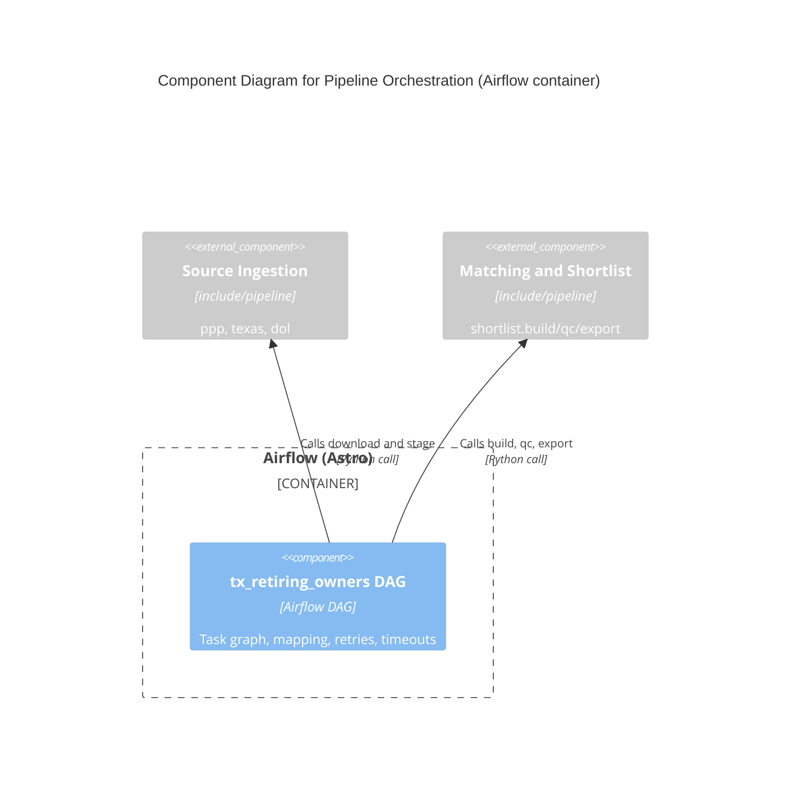

# C4 Component Level: Pipeline Orchestration

## Overview

- **Name**: Pipeline Orchestration
- **Description**: The Airflow DAG `tx_retiring_owners` that wires download, stage, build, QC and export tasks into one daily run.
- **Type**: Application (Airflow DAG)
- **Technology**: Python, Airflow 3 (`airflow.sdk` `@dag`/`@task`, dynamic task mapping), Astro runtime

## Purpose

Schedules and sequences the pipeline. It holds no business logic: each task is a thin wrapper that calls one function in `include/pipeline` and returns its count or flag as the XCom. It sets schedule, retries, timeouts and concurrency caps.

## Software Features

- Daily schedule (`@daily`, start 2026-10-01 UTC, `catchup=False`, `max_active_runs=1`, not paused on creation).
- Default `retries=2`, `retry_delay=5 min`; per-task `execution_timeout` (30 min to 2 h).
- Dynamic task mapping: `ppp_download` over URLs from `ppp_discover`; `tx_download`/`tx_stage` over `texas.DATASETS`; `dol_download` over the 8 URLs built from `dol.YEARS x dol.FORMS`.
- Concurrency caps: `ppp_download` 3 and `dol_download` 2 (`max_active_tis_per_dag`).
- Fan-in: `[ppp_staged, tx_staged, dol_staged] >> build`, then `qc(run_date) >> export(run_date)`. `build` returns a dict, so `qc` and `export` receive the `run_date` build used.

## Code Elements

- [c4-code-dags.md](./c4-code-dags.md) - `dags/tx_retiring_owners.py`: DAG definition and tasks.

## Interfaces

### DAG `tx_retiring_owners`

- **Protocol**: Airflow scheduler / REST API (`/api/v2`), UI at http://localhost:8080
- **Description**: The only entry point; triggered on schedule or manually.
- **Tasks**: `ppp_discover() -> list[str]`, `ppp_download(url: str) -> bool`, `ppp_stage() -> int`, `tx_download(name: str) -> bool`, `tx_stage(name: str) -> int`, `dol_download(url: str) -> bool`, `dol_stage() -> int`, `build() -> dict[str, object]`, `qc(run_date: str) -> None`, `export(run_date: str) -> dict[str, int]`

## Dependencies

### Components Used

- Source Ingestion: `ppp`, `texas`, `dol` functions and `texas.DATASETS`, `dol.YEARS`, `dol.FORMS`, `dol.url`.
- Matching and Shortlist: `shortlist.build`, `shortlist.qc`, `shortlist.export`.

### External Systems

- Airflow scheduler and metadata database (Airflow migrates its own DB on start).

## Verification: tests are not a runtime component. [c4-code-tests.md](./c4-code-tests.md) covers `tests/unit/` and `tests/dags/`; `scripts/smoke.sh` ([c4-code-scripts.md](./c4-code-scripts.md)) triggers one full `tx_retiring_owners` run against the running Astro app.

## Component Diagram

