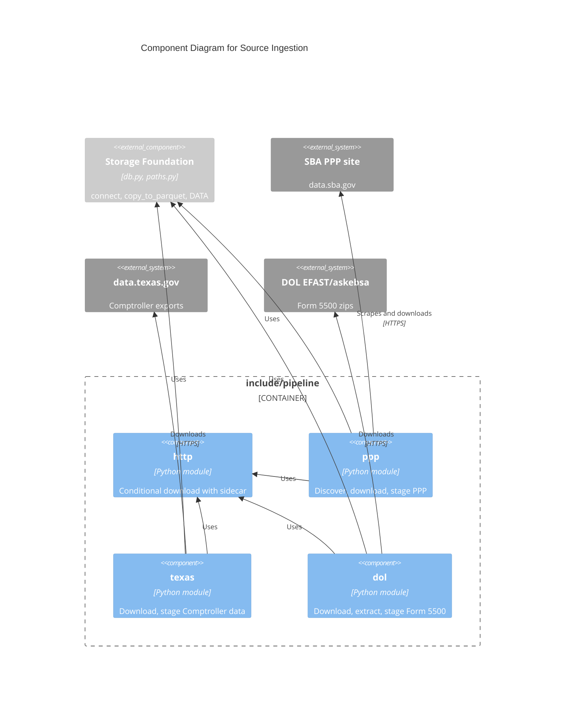

# C4 Component Level: Source Ingestion

## Overview

- **Name**: Source Ingestion
- **Description**: Conditional download of three public datasets and staging of each to a validated Parquet file.
- **Type**: Library (Python modules)
- **Technology**: Python, `requests`, DuckDB SQL, `zipfile`

## Purpose

Brings raw SBA PPP, Texas Comptroller and DOL Form 5500 data into `include/data/raw` and turns it into `include/data/stage/*.parquet`. Every stage function asserts a row floor and schema/key invariants before it writes, so a bad read never replaces the previous Parquet.

## Software Features

- Conditional download (`http.download_if_changed`): HEAD, compare ETag/Last-Modified and byte size with a `.meta.json` sidecar; stream to `.part`, check Content-Length, atomic rename. No retry loop (Airflow retries); raises if HEAD has neither ETag nor Last-Modified.
- PPP: scrape the listing page at `data.sba.gov/dataset/ppp-foia` for CSV links (`parse_links`, `discover`); stage Texas loans with a ZIP and a normalised name to `stage/ppp_tx.parquet` (floor 650,000 loans; fewer than 1,000 unusable rows).
- Texas Comptroller: datasets `tx_franchise` (`9cir-efmm`) and `tx_sales_outlets` (`jrea-zgmq`) from data.texas.gov; header must match the expected string; trims padding; derives an EIN from taxpayer numbers starting with 1; floors 3,000,000 and 800,000 rows; asserts no bad EINs.
- DOL: Form 5500 and 5500-SF "Latest" zips for 2022-2025; `extract` takes the single CSV; stage one row per Texas sponsor EIN to `stage/dol_5500_tx.parquet` (floor 46,000; unique EINs; Texas Instruments EIN 750289970 appears once).

## Code Elements

- [c4-code-include-pipeline.md](./c4-code-include-pipeline.md) - modules in `include/pipeline/`:
  - `http.py` - conditional download helper (`HEADERS`, `TIMEOUT`).
  - `ppp.py` - PPP discovery, download, staging.
  - `texas.py` - Comptroller download and staging.
  - `dol.py` - DOL download, extraction, staging.

## Interfaces

### Python functions (called by Pipeline Orchestration)

- **Protocol**: in-process Python call; HTTPS to sources; files (CSV/zip in, Parquet out)
- **Operations**:
  - `http.download_if_changed(url: str, dest: Path) -> bool` - True if a new file was written.
  - `ppp.parse_links(html: str) -> list[str]`, `ppp.discover(data: Path = DATA) -> list[str]`
  - `ppp.download(url: str, data: Path = DATA) -> bool`
  - `ppp.stage_tx(data: Path = DATA, min_rows: int = 650_000) -> int`
  - `texas.DATASETS: dict[str, str]`, `texas.download(name: str, data: Path = DATA) -> bool`
  - `texas.stage(name: str, data: Path = DATA, min_rows: int | None = None) -> int`
  - `dol.YEARS`, `dol.FORMS`, `dol.url(form: str, year: int) -> str`
  - `dol.download(url: str, data: Path = DATA) -> bool`, `dol.extract(zip_path: Path) -> Path`
  - `dol.stage(data: Path = DATA, min_rows: int = 46_000) -> int`

### Parquet outputs (consumed by Matching and Shortlist)

- **Protocol**: files under `include/data/stage/`: `ppp_tx.parquet`, `tx_franchise.parquet`, `tx_sales_outlets.parquet`, `dol_5500_tx.parquet`.

## Dependencies

### Components Used

- Storage Foundation: `connect`, `copy_to_parquet`, `DATA`.

### External Systems

- SBA PPP site (data.sba.gov), HTTPS.
- data.texas.gov, HTTPS (CSV export, no Content-Length).
- DOL EFAST/askebsa (`askebsa.dol.gov/FOIA Files`), HTTPS (301 to www host).

## Verification: tests are not a runtime component. [c4-code-tests.md](./c4-code-tests.md) covers `tests/unit/` and `tests/dags/`; `scripts/smoke.sh` ([c4-code-scripts.md](./c4-code-scripts.md)) triggers one full `tx_retiring_owners` run against the running Astro app.

## Component Diagram

