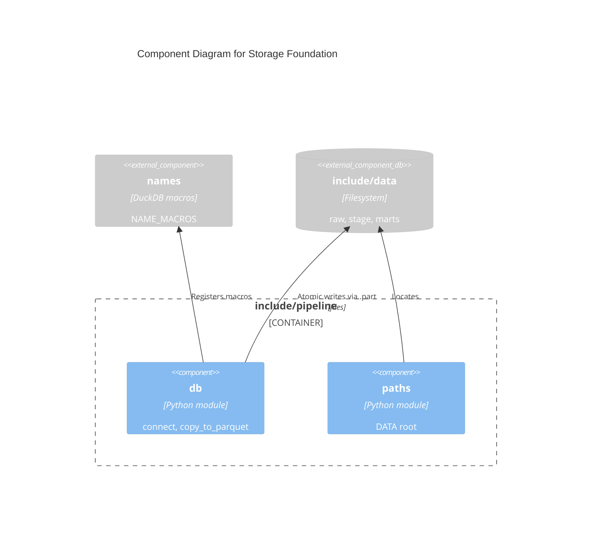

# C4 Component Level: Storage Foundation

## Overview

- **Name**: Storage Foundation
- **Description**: DuckDB connection factory, atomic Parquet/CSV writer and the data root.
- **Type**: Library (Python modules)
- **Technology**: Python, DuckDB

## Purpose

Gives every stage and mart step the same connection setup and a write that never leaves a half-written or replaced-by-failure output.

## Software Features

- `connect`: in-memory DuckDB, `memory_limit = '8GB'` (up to four stage tasks run at once), registers `NAME_MACROS`.
- `copy_to_parquet`: `COPY` the query to `<dest>.part`, then `os.replace`; on any failure the `.part` is removed and the previous dest stays. `fmt="csv"` writes CSV with a header. Returns the row count.
- `DATA`: `include/data` on the host, `/usr/local/airflow/include/data` in containers (gitignored; layout `raw/`, `stage/`, `marts/`).

## Code Elements

- [c4-code-include-pipeline.md](./c4-code-include-pipeline.md) - `db.py`, `paths.py`.

## Interfaces

- **Protocol**: in-process Python call; files
- **Operations**:
  - `db.connect() -> duckdb.DuckDBPyConnection`
  - `db.copy_to_parquet(con, query: str, dest: Path, params: list[object] | None = None, fmt: Literal["parquet", "csv"] = "parquet") -> int`
  - `paths.DATA: Path`

## Dependencies

### Components Used

- Matching and Shortlist: `db.py` imports `names.NAME_MACROS`. This is a dependency from the foundation up to a Matching module; keep `names.py` free of imports to avoid a cycle.

### External Systems

- Local `include/data` filesystem; DuckDB (embedded).

## Verification: tests are not a runtime component. [c4-code-tests.md](./c4-code-tests.md) covers `tests/unit/` and `tests/dags/`; `scripts/smoke.sh` ([c4-code-scripts.md](./c4-code-scripts.md)) triggers one full `tx_retiring_owners` run against the running Astro app.

## Component Diagram

