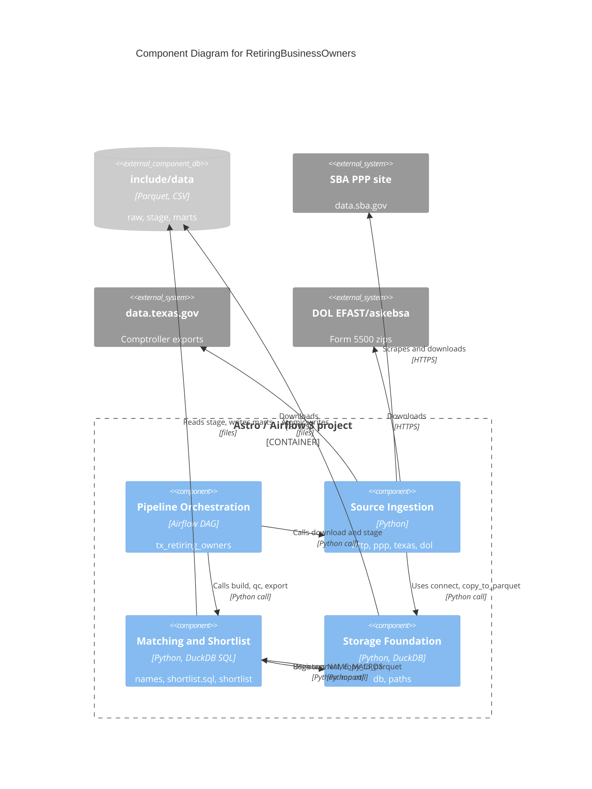

# C4 Component Level: System Overview

Components of the `tx_retiring_owners` pipeline. Tests and `scripts/smoke.sh` are verification, noted under each component, not components.

## System Components

### Pipeline Orchestration
- **Description**: Airflow DAG, task graph, dynamic mapping, retries and timeouts.
- **Documentation**: [c4-component-pipeline-orchestration.md](./c4-component-pipeline-orchestration.md)

### Source Ingestion
- **Description**: Conditional download and validated Parquet staging for SBA PPP, Texas Comptroller and DOL Form 5500 (`http.py`, `ppp.py`, `texas.py`, `dol.py`).
- **Documentation**: [c4-component-source-ingestion.md](./c4-component-source-ingestion.md)

### Matching and Shortlist
- **Description**: Name normalisation, PPP-to-registration matching, QC and CSV export (`names.py`, `sql/shortlist.sql`, `shortlist.py`, `naics_2017.csv`).
- **Documentation**: [c4-component-matching-and-shortlist.md](./c4-component-matching-and-shortlist.md)

### Storage Foundation
- **Description**: DuckDB connection, atomic Parquet/CSV writes and the data root (`db.py`, `paths.py`).
- **Documentation**: [c4-component-storage-foundation.md](./c4-component-storage-foundation.md)

## Component Relationships

