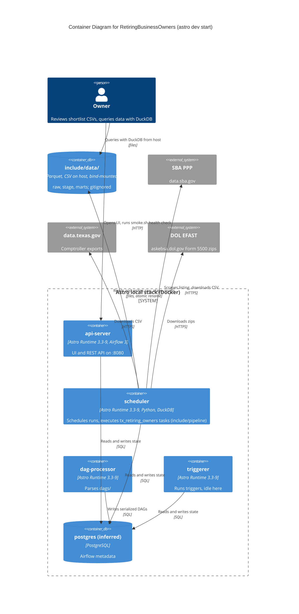

# C4 Container Level: System Deployment

The system runs locally with `astro dev start` (see [CLAUDE.md](../CLAUDE.md)). The repo has no compose file of its own beyond [docker-compose.override.yml](../docker-compose.override.yml); the base compose is generated by the Astro CLI.

## Provenance: what is from repo files and what is inferred

**From repo files**
- Base image: `FROM astrocrpublic.azurecr.io/runtime:3.3-9` ([Dockerfile](../Dockerfile)). Astro Runtime 3.x is Airflow 3 (CLAUDE.md also states "Airflow 3").
- The override file configures exactly four services by name: `scheduler`, `dag-processor`, `api-server`, `triggerer`. Each gets `user: "1000:0"` and `USER: astro`. This confirms those four exist in the generated compose.
- Python dependency installed in the image: `duckdb==1.5.6` ([requirements.txt](../requirements.txt)). [packages.txt](../packages.txt) is empty (no OS packages). `requests` is in [pyproject.toml](../pyproject.toml) for host use only; it is not in requirements.txt (see Not verified).
- `include/data/` is gitignored and in `.dockerignore`, and CLAUDE.md says it lives on the host; the override comment says host uid 1000 owns "the bind mounts" and the image's uid 50000 could not write `include/data`. `DATA` resolves to `/usr/local/airflow/include/data` in containers ([storage foundation doc](./c4-component-storage-foundation.md)).
- [.astro/config.yaml](../.astro/config.yaml) is tracked and holds only `project.name: retiring-business-owners`.

**Inferred from the Astro CLI, not from repo files**
- A `postgres` metadata DB container exists (the repo never mentions it; the orchestration component doc says only "Airflow migrates its own database on start").
- The base compose mounts the project (`dags/`, `include/`, `plugins/`) into `/usr/local/airflow`, and publishes the api-server on `localhost:8080` (smoke.sh uses that port).
- Airflow executor is the Astro local default (LocalExecutor); not set anywhere in the repo.
- No resource limits (CPU/memory) are set in the repo's override; the Astro-generated compose is assumed to set none.
- No Celery workers, Redis, or standalone worker container: nothing in the repo defines them, and the inferred local executor does not need them.

## Containers

### Airflow API Server

- **Name**: api-server
- **Description**: Airflow 3 API server: web UI and REST API.
- **Type**: Web application and API
- **Technology**: Astro Runtime 3.3-9 (Airflow 3), Python
- **Deployment**: Docker container from the project image, run by `astro dev start`; override sets `user: "1000:0"`, `USER=astro`.

### Airflow Scheduler

- **Name**: scheduler
- **Description**: Schedules DAG runs and executes tasks (local executor, inferred). The `include/pipeline` code runs in task processes started from here.
- **Type**: Application (scheduler and task runner)
- **Technology**: Astro Runtime 3.3-9, Python, DuckDB 1.5.6, requests (assumed present in the runtime image; see Not verified)
- **Deployment**: Docker container, same image and override as above.

### Airflow DAG Processor

- **Name**: dag-processor
- **Description**: Parses `dags/` and serializes DAGs into the metadata DB.
- **Type**: Application
- **Technology**: Astro Runtime 3.3-9, Python
- **Deployment**: Docker container, same image and override.

### Airflow Triggerer

- **Name**: triggerer
- **Description**: Runs deferrable-task triggers. The `tx_retiring_owners` DAG, as documented, uses no deferrable operators, so it is idle for this project.
- **Type**: Application
- **Technology**: Astro Runtime 3.3-9, Python
- **Deployment**: Docker container, same image and override.

### Airflow Metadata Database (inferred)

- **Name**: postgres
- **Description**: Airflow metadata store (DAG runs, task state, XComs). Migrated by Airflow on start.
- **Type**: Database
- **Technology**: PostgreSQL (version set by the Astro CLI)
- **Deployment**: Docker container generated by the Astro CLI. Not defined in the repo.

### Host Data Store (not a container)

- **Name**: `include/data/`
- **Description**: Pipeline data lake: `raw/`, `stage/*.parquet`, `marts/` (Parquet and CSV exports). Gitignored.
- **Type**: File system (bind mount)
- **Technology**: Parquet, CSV; read from the host with DuckDB (CLAUDE.md)
- **Deployment**: Host directory, bind-mounted into the Airflow containers at `/usr/local/airflow/include/data` (mount mechanism inferred; see above).

## Purpose

The four Airflow containers share one image: the same code (`dags/`, `include/`, `duckdb`) is present in each, but only the scheduler's task processes run the pipeline code. All pipeline state lives as files in `include/data/`; Postgres holds Airflow's own state only. There is no database server for the data: DuckDB is embedded, in-memory (`db.connect()`), and writes Parquet and CSV.

## Components

| Component | Deployed in | Documentation |
|---|---|---|
| Pipeline Orchestration (`dags/tx_retiring_owners.py`) | dag-processor (parses), scheduler (runs tasks) | [c4-component-pipeline-orchestration.md](./c4-component-pipeline-orchestration.md) |
| Source Ingestion (`include/pipeline/{http,ppp,texas,dol}.py`) | scheduler (task processes) | [c4-component-source-ingestion.md](./c4-component-source-ingestion.md) |
| Matching and Shortlist (`names.py`, `sql/shortlist.sql`, `shortlist.py`, `naics_2017.csv`) | scheduler (task processes) | [c4-component-matching-and-shortlist.md](./c4-component-matching-and-shortlist.md) |
| Storage Foundation (`db.py`, `paths.py`) | scheduler (task processes) | [c4-component-storage-foundation.md](./c4-component-storage-foundation.md) |

Overview: [c4-component.md](./c4-component.md). The "scheduler runs tasks" placement follows from the inferred local executor; under any other executor the tasks would run in that executor's workers.

## Interfaces

This project exposes **no API of its own**, so there is no OpenAPI spec in this repo. The only HTTP interface is Airflow's own REST API, served by the api-server on `http://localhost:8080`. Official spec: [Airflow REST API reference](https://airflow.apache.org/docs/apache-airflow/stable/stable-rest-api-ref.html) (the Airflow 3 `/api/v2` OpenAPI document, also served by the running api-server at `/openapi.json`; the second location is Airflow's standard behaviour, not checked here).

### Airflow REST API calls made by [scripts/smoke.sh](../scripts/smoke.sh)

- **Protocol**: HTTP, no TLS, `localhost:8080`
- **Auth**: none. The script sends no credentials or headers.
- **Endpoints**:
  - `GET /api/v2/monitor/health` via `curl -fsS`, output discarded; a non-2xx response aborts the script (`set -e`).

All other smoke.sh steps do **not** use REST. They use `astro dev run` (Airflow CLI inside the container): `dags unpause tx_retiring_owners`, `dags trigger tx_retiring_owners -r smoke__<UTC timestamp>`, and a 15-second poll of `dags list-runs tx_retiring_owners -o json` until `success`, `failed` or a timeout (default 600 s).

### Other interfaces

- Airflow UI at http://localhost:8080 (api-server).
- Host file interface: `include/data/` queried with DuckDB from the host (no server).
- DAG `tx_retiring_owners`: see [orchestration doc](./c4-component-pipeline-orchestration.md).

## Dependencies

| From | To | Protocol |
|---|---|---|
| scheduler, dag-processor, api-server, triggerer | postgres (inferred) | SQL (PostgreSQL wire protocol) |
| scheduler (task processes) | SBA PPP site, `data.sba.gov` | HTTPS (listing scrape, CSV download) |
| scheduler (task processes) | `data.texas.gov` | HTTPS (CSV export) |
| scheduler (task processes) | DOL EFAST/askebsa (`askebsa.dol.gov`) | HTTPS (zip download, 301 to www host) |
| scheduler (task processes) | `include/data/` | Filesystem (bind mount), atomic `.part` then rename |
| host user / DuckDB CLI | `include/data/` | Filesystem, read |
| host (`smoke.sh`, browser) | api-server | HTTP, port 8080 |
| host (`smoke.sh`) | Airflow CLI in a container | `astro dev run` |

External sources: see the [source ingestion doc](./c4-component-source-ingestion.md).

## Infrastructure

- **Deployment config**: [Dockerfile](../Dockerfile), [docker-compose.override.yml](../docker-compose.override.yml), [requirements.txt](../requirements.txt), [packages.txt](../packages.txt) (empty), [.astro/config.yaml](../.astro/config.yaml), [.dockerignore](../.dockerignore). Host tooling: [mise.toml](../mise.toml) (python 3.14, uv 0.13.0, astro 1.46.0; task `check` runs pre-commit, pytest, `astro dev parse`), [pyproject.toml](../pyproject.toml) (host venv; `requires-python >=3.14,<3.15`), [orca.yaml](../orca.yaml) (worktree setup script only: mise trust and install, `uv sync`, pre-commit install). `airflow_settings.yaml` is an unfilled Astro template (empty connection, pool and variable entries), and `git ls-files` did not list it, so it is not in the tracked repo.
- **Run as**: all four Airflow containers as uid 1000, gid 0 ([override](../docker-compose.override.yml)), so writes to the bind-mounted `include/data` are owned by the host user.
- **Scaling**: single-host local stack, one instance of each container, no replication. DAG-level limits only: `max_active_runs=1`, `max_active_tis_per_dag` 3 for `ppp_download` and 2 for `dol_download`.
- **Resources**: the override sets no CPU or memory limits. The one explicit cap is DuckDB's `SET memory_limit = '8GB'` per connection in [include/pipeline/db.py](../include/pipeline/db.py), sized for up to four concurrent stage tasks. That is a per-connection setting, so up to four connections could together reach 4 x 8 GB; the 8 GB is not a container limit and is not shared across tasks. Task timeouts: 30 min to 2 h per task; DAG retries 2, 5 min delay.
- **Data**: `include/data/` persists on the host across container restarts and is gitignored. Metadata DB persistence is Astro CLI behaviour (not checked).

## Container Diagram

Postgres connections from api-server, dag-processor and triggerer are inferred from standard Airflow 3 architecture, not from repo files.

## Not verified

- No running stack was inspected (`docker compose config`, `docker ps`); container list, mounts, executor and Postgres are from the repo plus Astro CLI knowledge.
- `requests` is declared in pyproject.toml but not in requirements.txt; whether the Runtime image already ships it was not checked. Ingestion depends on it ([source ingestion doc](./c4-component-source-ingestion.md)).
- The Airflow `/openapi.json` location is general Airflow behaviour, not tested.
