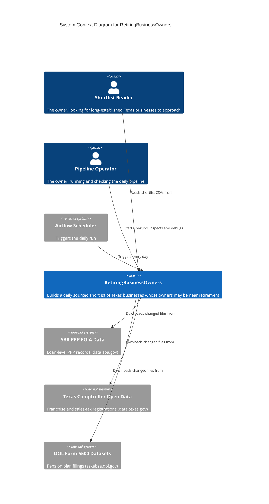

# C4 Context Level: System Context

## System Overview

### Short Description

RetiringBusinessOwners is a local daily pipeline that turns three free public Texas and federal data sets into a sourced shortlist of long-established Texas businesses whose owners may be near retirement.

### Long Description

The system is one Airflow pipeline, `tx_retiring_owners`, that runs on one machine in Docker. Every day (00:00 UTC, which is 19:00 Central) it checks three public data sources, downloads only the files that have changed, matches the businesses across them, and writes a shortlist as CSV files (`docs/specs/00-product/spec.md`, decisions 3, 6 and 7).

**What the shortlist is.** Each row is a Texas business that took an SBA PPP loan, matched to its Texas state registration, and has at least 30 years of evidence of being in business (`MIN_YEARS = 30` in `include/pipeline/shortlist.py`). Business age uses the oldest of three dates: the state charter date, the first sales-tax sale, and the earliest pension plan start. Each row records which of these set the age (`age_source`) and how confident the match is (`match_tier`, 1 to 4). Rows are sorted by years in business, then by whether the business has ever had a defined-benefit pension plan, then by jobs reported, then by name. There is no scoring model. Organizations that are not businesses (religious and civic groups, private households, public administration), nonprofits and charged-off loans are left out. Rows carry the pension-plan signer's name when the plan's administrator is the sponsor itself, which is often but not always the owner (product spec, "Riskiest unknowns").

**Why these three sources.** Each answers a different question, and all are free public records:

- SBA PPP loan data lists many small businesses with name, address, industry, jobs and loan details.
- Texas Comptroller data confirms the business is registered in Texas and gives its charter date, first sales date and a taxpayer number, from which the federal EIN is derived.
- DOL Form 5500 pension filings join to the Comptroller data by that EIN exactly, and add the plan start date (older evidence of age), participant counts and a signer name.

The pipeline is meant to be correct, cheap to re-run and loud when something breaks: quality checks fail the run on a low match rate, duplicates, or wrong age bounds (`qc` task).

**Not in this system (phase 1).** No outreach, no CRM, no other states, no web app and no login (product spec, "Anti-goals").

**Planned, not built.** Phase 2 specs 05 to 08 are unchecked in the product spec: Google Places enrichment, website text, an LLM read of owner signals, and drafted starter letters. They would add Google Places and Anthropic as external systems. They are shown below only as planned.

## Personas

### Shortlist Reader (the owner)

- **Type**: Human User
- **Description**: The repo owner, the single intended user, who is looking for a long-established Texas business to buy or approach. Works on this machine only (product spec, "Users").
- **Goals**: Get a fresh, sourced list of candidate businesses each morning, and see quickly which ones are new.
- **Key Features Used**: Daily Shortlist, New-Since-Previous List, Shortlist Tuning.

### Pipeline Operator (the owner, in a second role)

- **Type**: Human User
- **Description**: The same person when they start the stack, check that the daily run is green, re-run it, or investigate a failure. Documented in `CLAUDE.md` and the product spec.
- **Goals**: Keep the daily run green, re-run cheaply, find the cause of a failure quickly, and inspect intermediate data.
- **Key Features Used**: Daily Pipeline Run, Smoke Re-run, Failure Investigation, Data Inspection.

### Airflow Scheduler

- **Type**: Programmatic User
- **Description**: The Airflow scheduler inside the Astro stack. It triggers the `tx_retiring_owners` DAG every day, with retries (2, five minutes apart) and no catch-up of old days (`dags/tx_retiring_owners.py`, see [c4-component-pipeline-orchestration.md](./c4-component-pipeline-orchestration.md)).
- **Goals**: Run the whole pipeline on schedule without a person.
- **Key Features Used**: Daily Pipeline Run.

## System Features

### Daily Pipeline Run

- **Description**: Once a day the system downloads changed source files, stages them, matches them and runs quality checks. Downloads are conditional, so unchanged files are skipped.
- **Users**: Airflow Scheduler, Pipeline Operator (can trigger manually).
- **User Journey**: [Daily Run Journey](#daily-run---airflow-scheduler-journey)

### Daily Shortlist

- **Description**: A full CSV snapshot, `include/data/marts/shortlist_latest.csv`, of long-established Texas businesses with evidence, match confidence and age source.
- **Users**: Shortlist Reader.
- **User Journey**: [Review the shortlist](#review-the-shortlist---shortlist-reader-journey)

### New-Since-Previous List

- **Description**: `include/data/marts/shortlist_new_since_previous.csv` lists businesses that were not in the previous exported shortlist. If there is no earlier shortlist, every row counts as new (spec 04).
- **Users**: Shortlist Reader.
- **User Journey**: [Review new entries](#review-new-since-previous-entries---shortlist-reader-journey)

### Quality Gates

- **Description**: The run fails, rather than publishing a doubtful shortlist, when the match share is under 30%, fewer than 100 rows are produced, taxpayer numbers repeat, any row is under 30 years old or lacks an age source, or any row is a nonprofit or charged-off loan. Each source stage also checks its own row floors and sentinel rows (product spec, decision 12).
- **Users**: Pipeline Operator (sees the failures), Airflow Scheduler.
- **User Journey**: [Investigate a failed run](#investigate-a-failed-run---pipeline-operator-journey)

### Shortlist Tuning

- **Description**: The minimum years in business and the excluded industry codes are constants in `include/pipeline/shortlist.py`. Editing them and re-running changes the shortlist without touching SQL.
- **Users**: Pipeline Operator, Shortlist Reader.
- **User Journey**: [Tune the shortlist](#tune-the-shortlist---owner-journey)

### Smoke Re-run

- **Description**: `scripts/smoke.sh` triggers one full DAG run against the running stack and waits for success. A single task can also be re-run from the Airflow UI at http://localhost:8080.
- **Users**: Pipeline Operator.
- **User Journey**: [Daily Run Journey](#daily-run---airflow-scheduler-journey) (manual variant)

### Data Inspection

- **Description**: Source, staged and result data sit as files in the gitignored `include/data/` folder and can be queried from the host with DuckDB.
- **Users**: Pipeline Operator, Shortlist Reader.
- **User Journey**: [Query the data](#query-the-data-with-duckdb---pipeline-operator-journey)

### Planned: Enrichment and Letters (not built)

- **Description**: Google Places reviews and website text, an LLM read for signs the owner still runs the business, and up to 50 drafted starter letters (specs 05 to 08, unchecked). Nothing is sent automatically; the owner edits, signs and posts letters.
- **Users**: Shortlist Reader.
- **User Journey**: None yet.

## User Journeys

### Daily Run - Airflow Scheduler Journey

1. Schedule fires: the Airflow Scheduler starts `tx_retiring_owners` at 00:00 UTC. (Operator variant: run `scripts/smoke.sh`, or trigger it from the Airflow UI.)
2. Check sources: the system asks each external source whether its files changed (ETag and Last-Modified are compared with the saved copy in `include/data/raw/`).
3. Download changes: only changed files are fetched, so a repeat run logs `unchanged`. Touchpoints: SBA PPP site, data.texas.gov, DOL.
4. Stage: each source is cleaned into one Parquet file under `include/data/stage/` with row-count checks.
5. Match: PPP businesses are matched to Texas registrations in four tiers; a match counts only when exactly one taxpayer qualifies. The EIN joins the pension data, and years in business are computed.
6. Check quality: `qc` fails the run on any gate listed above.
7. Export: the two CSVs are written to `include/data/marts/`. A dated shortlist copy is kept under `marts/shortlist/run_date=<date>/`.

### Review the Shortlist - Shortlist Reader Journey

1. Open `include/data/marts/shortlist_latest.csv` in a spreadsheet.
2. Read the oldest businesses first (the file is pre-sorted).
3. For each row, look at business name, address, industry, jobs, years in business and `age_source`, whether a pension plan exists, and the plan signer name if present.
4. Judge how far to trust a row by `match_tier` (1 is strongest).
5. Pick candidates to look into further by hand. The system does no outreach.

### Review New-Since-Previous Entries - Shortlist Reader Journey

1. After the run is green, open `include/data/marts/shortlist_new_since_previous.csv`.
2. Review only businesses that were not in the previous exported shortlist.
3. Check anything surprising against `shortlist_latest.csv`.

### Investigate a Failed Run - Pipeline Operator Journey

1. Open the Airflow UI at http://localhost:8080 and find the red task in `tx_retiring_owners`.
2. Read its task log. From the repo root, the command in `CLAUDE.md` runs `docker exec` on this repo's scheduler container and prints `logs/dag_id=tx_retiring_owners/run_id=<run>/task_id=<task>/attempt=1.log`. Mapped tasks have a `map_index=<n>/` folder before `attempt=1.log`.
3. Failure messages name the file and the numbers (for example a row count below its floor).
4. Fix the cause, then re-run the failed task from the Airflow UI or run `scripts/smoke.sh`. Writes are atomic and tasks are re-runnable, so a crash leaves no half-written file.

### Query the Data with DuckDB - Pipeline Operator Journey

1. From the host, query files in `include/data/` with DuckDB, for example `select match_tier, count(*) from 'include/data/marts/matches.parquet' group by 1 order by 1` (spec 04).
2. Look at `raw/` (downloads), `stage/` (one Parquet per source) and `marts/` (matches and shortlist) to see where a business was gained or lost.

### Tune the Shortlist - Owner Journey

1. Edit `MIN_YEARS` or `EXCLUDED_NAICS` in `include/pipeline/shortlist.py`.
2. Run `scripts/smoke.sh` (or trigger the DAG from the Airflow UI).
3. Open the refreshed CSVs.

### First-time Start - Pipeline Operator Journey

1. Install and start per `CLAUDE.md`: `mise trust && mise install && uv sync && uv run pre-commit install`, then `astro dev start`.
2. Open http://localhost:8080 and confirm the DAG runs. The first run downloads about 10 GB of source files; later runs download only changes.

## External Systems and Dependencies

### SBA PPP FOIA Data

- **Type**: Public government data download (data.sba.gov)
- **Description**: Loan-level Paycheck Protection Program records: 13 CSV files, about 4.5 GB. The dataset is listed as last modified 2024-10-21 with an irregular refresh (`docs/data-sources.md`).
- **Integration Type**: HTTPS file download. The system reads the dataset page to find the CSV links, because the catalogue API returns 404. It then checks ETag and Last-Modified and downloads only changed files.
- **Purpose**: Supplies the business list: name, address, industry code, jobs and loans. Only Texas loans are kept.
- **URLs**: https://data.sba.gov/dataset/ppp-foia and files under https://data.sba.gov/sites/default/files/distribution/SBA-OCA-2022-07-001/

### Texas Comptroller Open Data

- **Type**: Public government open-data portal (data.texas.gov)
- **Description**: Two weekly-refreshed data sets: Active Franchise Taxpayers (`9cir-efmm`) and Active Sales Tax Permit Holders (`jrea-zgmq`).
- **Integration Type**: HTTPS CSV export download, conditional on ETag and Last-Modified. No login needed. A free app token is the documented fallback if the portal throttles with HTTP 429 (not needed so far).
- **Purpose**: Confirms Texas registration, gives charter date and first sales date, trade names (DBA), and the taxpayer number from which the federal EIN is derived.
- **URLs**: https://data.texas.gov/api/views/9cir-efmm/rows.csv?accessType=DOWNLOAD and https://data.texas.gov/api/views/jrea-zgmq/rows.csv?accessType=DOWNLOAD

### DOL EFAST2 Form 5500 Datasets

- **Type**: Public government data download (U.S. Department of Labor, EBSA, host askebsa.dol.gov)
- **Description**: Annual retirement-plan filings. The pipeline uses the "Latest" Form 5500 and Form 5500-SF zip files for form years 2022 to 2025 (8 files), refreshed roughly monthly.
- **Integration Type**: HTTPS zip download, conditional on ETag and Last-Modified. The host redirects to `www.askebsa.dol.gov`.
- **Purpose**: Adds pension plan start date, participant counts, plan type and the plan signer's name per Texas sponsor, joined by EIN.
- **URLs**: https://www.dol.gov/agencies/ebsa/about-ebsa/our-activities/public-disclosure/foia/form-5500-datasets and files such as https://askebsa.dol.gov/FOIA%20Files/2024/Latest/F_5500_2024_Latest.zip

### Census NAICS 2017 Code List (reference data)

- **Type**: Public reference file
- **Description**: `https://www.census.gov/naics/2017NAICS/2-6%20digit_2017_Codes.xlsx` appears in the code base as the origin of the industry titles in the bundled `include/pipeline/naics_2017.csv` (see [c4-component-matching-and-shortlist.md](./c4-component-matching-and-shortlist.md)). It is not downloaded by the daily run.

### Planned External Systems (not built)

- **Google Places API** (specs 05): reviews and website of shortlisted businesses. Needs `GOOGLE_MAPS_API_KEY`.
- **Anthropic API (Claude Haiku)** (spec 07): reads reviews and website text for owner signals. Needs `ANTHROPIC_API_KEY`.
- **Business websites** (spec 06): homepage and about pages, respecting robots.txt.

## System Context Diagram

## Related Documentation

- [Container Documentation](./c4-container.md)
- [Component Documentation](./c4-component.md)
- Product spec: [docs/specs/00-product/spec.md](../docs/specs/00-product/spec.md)
- Feature specs: [00-skeleton](../docs/specs/00-skeleton/spec.md), [01-ppp-extract](../docs/specs/01-ppp-extract/spec.md), [02-tx-comptroller-extract](../docs/specs/02-tx-comptroller-extract/spec.md), [03-dol-5500-extract](../docs/specs/03-dol-5500-extract/spec.md), [04-match-and-shortlist](../docs/specs/04-match-and-shortlist/spec.md)
- Source facts: [docs/data-sources.md](../docs/data-sources.md)
