<p align="center">
  <picture>
    <source media="(prefers-color-scheme: dark)" srcset="docs/assets/logo-dark.svg" />
    
  </picture>
</p>

<h3 align="center">Every US business in the public record, merged into one row each,<br/>with its industry, its age, and whether it is still open.</h3>

<p align="center">
  <a href="https://airflow.apache.org/"></a>
  <a href="https://www.astronomer.io/"></a>
  <a href="https://duckdb.org/"></a>
  <a href="https://parquet.apache.org/"></a>
  <a href="https://www.python.org/"></a>
  <a href="https://www.docker.com/"></a>
</p>

<p align="center">
  <a href="docs/diagrams/overview.html">
    <picture>
      <source media="(prefers-color-scheme: dark)" srcset="docs/diagrams/overview-dark.svg" />
      
    </picture>
  </a>
</p>

<p align="center">A daily Apache Airflow and DuckDB pipeline that pulls <b>48.8 GB</b> of federal and state public records, resolves <b>65.1 million</b> records into <b>44.8 million</b> businesses without ever guessing a match, and publishes one Parquet file you can query from a laptop.</p>

<p align="center">
  <a href="#how-it-works"><strong>How it works</strong></a> &nbsp;·&nbsp;
  <a href="#architecture"><strong>Architecture</strong></a> &nbsp;·&nbsp;
  <a href="#entity-resolution"><strong>Entity resolution</strong></a> &nbsp;·&nbsp;
  <a href="#quick-start"><strong>Quick start</strong></a> &nbsp;·&nbsp;
  <a href="#the-output"><strong>Output</strong></a> &nbsp;·&nbsp;
  <a href="#disclaimer"><strong>Disclaimer</strong></a>
</p>

<p align="center">
  
  
  
  
  <a href="tests/unit"></a>
  <a href="LICENSE"></a>
</p>

<p align="center">
  <a href="https://github.com/astral-sh/uv"></a>
  <a href="https://github.com/astral-sh/ruff"></a>
  <a href="https://mypy.readthedocs.io/"></a>
  <a href="https://pre-commit.com/"></a>
</p>

## At a glance

Measured on the latest full run (2026-10-19), on one machine:

| **48.8 GB** | **65.1 M** | **44.8 M** | **3.39 M** |
| :---: | :---: | :---: | :---: |
| raw public records in 191 files, kept exactly as published | source records staged into typed Parquet, from 19 datasets | businesses out, one row each, 127 columns | businesses merged from two or more sources |
| **99.2 %** | **0 bytes** | **1 file** | **≈ 15 min** |
| of businesses carry a years-in-business figure | re-downloaded on a day when no publisher changed a file | `businesses.parquet`, byte-identical when the input is unchanged | for the full merge of every source |

## Why it exists

Owners of long-running small businesses who are near retirement are hard to find. No single public dataset says how old a business is, what it does, and whether it is still open, but many datasets each say a little. This pipeline joins them, and stays honest about what it doesn't know.

| **Correct before clever** | **Cheap to re-run** |
| :--- | :--- |
| A record joins a business only when exactly one candidate fits. Two rows for one business are acceptable; one row for two businesses is not. | Only files a publisher changed are downloaded again, every write is atomic, and any task can be re-run at any time. |
| **Loud when it breaks** | **Small, boring stack** |
| Every source has a row-count floor in `qc`. No fallback defaults, no swallowed exceptions, no `ignore_errors`. | One machine, Docker, Airflow, DuckDB and Parquet. No Spark, no warehouse, no pandas, nothing to migrate. |

## How it works

| Step | What happens |
| --- | --- |
| **Discover** | Each source module lists today's files: CKAN and Socrata APIs, scraped download pages, SFTP listings, dated SAM.gov extracts. |
| **Download** | Only changed files are fetched, checked by `ETag` / `Last-Modified`, a SHA-256 of the body, a one-byte ranged `GET`, or SFTP size and mtime. Files land in `raw/` exactly as published. |
| **Stage** | DuckDB streams every file into one strictly typed Parquet per source, keeping all its rows: it trims, casts, drops exact duplicates and unkeyable rows, and never filters on business logic. |
| **Merge** | A five-step, seven-tier entity resolution joins records across sources into businesses and derives industry, years in business, lookup details and open status. |
| **Check** | `qc` fails the run if any source comes in under its row floor. |
| **Publish** | One snapshot, `include/data/marts/businesses.parquet`, is atomically replaced and read straight from the host with DuckDB. |

The ETL does no business filtering. Minimum age, industry and open status are columns, not cuts; every filter belongs to whoever reads the file.

## Architecture

<p align="center">
  <a href="docs/diagrams/runtime.html">
    <picture>
      <source media="(prefers-color-scheme: dark)" srcset="docs/diagrams/runtime-dark.svg" />
      
    </picture>
  </a>
</p>

- **Orchestration: Apache Airflow 3 on Astronomer's Astro Runtime,** run locally in Docker. One `@daily` DAG, `retiring_owners`, fans out into mapped download and stage tasks per source and file, then joins them in a single `build` and a `qc` gate.
- **Compute: DuckDB in-process.** It streams CSV and JSON, writes Parquet natively, and spills to disk when a statement outgrows its memory cap, so the merge handles more data than its memory limit.
- **Storage: files in three layers.** `raw/` holds the files as published, `stage/` one typed Parquet file per source, and `marts/` the output. There's no database to migrate or back up.
- **Clean boundaries.** Code under `include/` never imports Airflow, and a Ruff banned-API rule enforces it, so every transform runs and is tested on a laptop without Airflow. Everything about one state lives in one module: adding a state is one file, one line in `STATES`, a fixture and a test.

## Entity resolution

<p align="center">
  <a href="docs/diagrams/entity-resolution.html">
    <picture>
      <source media="(prefers-color-scheme: dark)" srcset="docs/diagrams/entity-resolution-dark.svg" />
      
    </picture>
  </a>
</p>

Names are normalized the same way everywhere: uppercase, `&` becomes `AND`, punctuation and a leading `THE` go, entity suffixes such as `INC` and `LLC` go, and a DBA is split off. Addresses give a five-digit ZIP and a street number. Then every tier accepts a candidate **only when exactly one fits**; anything ambiguous falls through to the next tier or stays unmatched.

| Tier | Joins a record to | On |
| :---: | --- | --- |
| 1 | a registry entity | normalized name + ZIP5, same state |
| 2 | a registry entity | normalized name + city, same state |
| 3 | a registry entity | Jaro-Winkler ≥ 0.92, same ZIP5 and street number |
| 4 | a registered trade name | name in the same ZIP5 |
| 5 to 7 | a Form 5500 plan sponsor | tiers 1 to 3 again |

Federal EINs add exact joins where they exist: Texas taxpayer numbers embed the EIN, Florida publishes it, and Form 5500 is keyed by it. Links always point at anchors, never from record to record, so one bad link can't chain two businesses together.

## Engineering highlights

- **Conditional downloads, four ways.** Most publishers answer `HEAD` with an `ETag` and `Last-Modified`. The rest need their own check, and each state module owns it: Iowa sends neither header, so a SHA-256 of the body decides; Virginia's S3 links reject `HEAD`, so a one-byte ranged `GET` reads the validators; Florida is SFTP, so size and modification time decide; SAM.gov dates its file names. Re-fetching 50 GB a day was the main failure mode this design removes.
- **Crash-safe, re-runnable tasks.** Every write goes to a `.part` file and is then renamed with `os.replace`, so a killed task never leaves half a file.
- **Reproducible output.** Transforms rebuild in full on every run and the output is sorted by `business_id`, so unchanged input produces a byte-identical file. Consecutive runs were checked by SHA-256.
- **Memory-bounded.** Each DuckDB connection has a `memory_limit`, mapped tasks run at most three at a time, and the merge spills to a temp directory. When Florida's 13 million entities pushed the merge out of memory, a per-statement profile found the three peak statements, and a rewrite of their joins brought the build back under its limit.
- **Typed and tested.** `mypy --strict`, Ruff, and 116 unit tests on fixtures for every state and national source, all wired into pre-commit. Every assertion message names the file and the numbers.
- **Spec-driven.** Each feature started as a written spec in [`docs/specs/`](docs/specs), with implementation notes beside it, and every commit body lists exactly what was verified against the running app and what was not.

## Sources

| Source | What it adds |
| --- | --- |
| **SBA Paycheck Protection Program** (11.47M loans) | name, address, NAICS industry, jobs reported, business age, loan amounts |
| **DOL Form 5500** and 5500-SF, form years 2009 to 2025 | EIN, plan sponsor and signer, plan start date, participants |
| **SBA 7(a) and 504 loans** | borrowers, approval dates, program, charge-offs |
| **SAM.gov entity extract** | federal contractors: UEI, CAGE, business start date |
| **FMCSA Company Census** | 4.5M motor carriers: USDOT number, officers, fleet size |
| **10 state business registries**: TX, FL, NY, PA, VA, CO, IA, CT, OR, DC | legal entity, formation date, status, officers, registered agent |
| **Texas sales-tax permits** | trading names and outlets |

The other states sell their registry data, put it behind a login, or forbid bulk use, so they get the national sources only. [`docs/data-sources.md`](docs/data-sources.md) lists every state, the reason, and what would unblock it.

## Quick start

### 1. Install

You need Docker and [mise](https://mise.jdx.dev/), which installs Python 3.14, uv and the Astro CLI. The full build needs about 60 GB of free disk and 48 GB of RAM; the merge peaks near 38 GB.

```bash
mise trust && mise install && uv sync && uv run pre-commit install
```

### 2. Run

```bash
astro dev start            # Airflow UI on http://localhost:8080
scripts/smoke.sh 7200      # trigger one full run and wait up to two hours for it
```

The `retiring_owners` DAG is unpaused on creation and then runs every day on its own.

### 3. Query

```sql
-- Texas businesses likely still open, with 30 or more years of evidence
select lookup_name, lookup_address, lookup_city, phone, naics_title, years_in_business
from 'include/data/marts/businesses.parquet'
where state = 'TX' and years_in_business >= 30 and open_status = 'likely_open'
order by years_in_business desc
limit 20;
```

Lint, type-check, test and parse the DAG with `mise run check`.

## The output

`include/data/marts/businesses.parquet` holds one row per business, with 127 columns.

| Group | Columns |
| --- | --- |
| **Identity** | `business_id`, `state`, `sources`, `registry_id`, `ein`, `names`, `match_tier` |
| **Industry** | `naics`, `naics_title`, `sector`, `industry_group`, `naics_source` |
| **Years in business** | `years_in_business`, `oldest_evidence_date`, `age_source` |
| **Google Maps lookup** | `lookup_name`, `lookup_address`, `lookup_city`, `lookup_state`, `lookup_zip5`, `phone` |
| **Open status** | `open_status` (`likely_open`, `likely_closed`, `unknown`), `open_evidence` |

<details>
<summary><b>Source detail columns</b></summary>

<br/>

Every other detail a source gives is carried too, so no filter needs a second join:

- **PPP:** `ppp_names`, `ppp_loan_count`, `ppp_total_approved`, `ppp_last_loan_date`, `jobs_reported`, `business_type`, `business_age_description`, `nonprofit`, `charged_off`
- **SBA 7(a) and 504:** `sba_loan_count`, `sba_total_approved`, `sba_first_loan_date`, `sba_last_loan_date`, `sba_programs`, `sba_charged_off`
- **SAM.gov:** `sam_uei`, `sam_cage`, `sam_start_date`, `sam_registration_status`, `sam_entity_structure`, `sam_poc_names`
- **FMCSA:** `usdot_number`, `fmcsa_status`, `fmcsa_add_date`, `fmcsa_officers`, `fmcsa_power_units`, `fmcsa_drivers`
- **Form 5500:** `plan_name`, `plan_signer_name`, `plan_eff_date`, `pension_codes`, `ever_defined_benefit`, `active_participants`, `plan_last_filed`
- **Registries:** `registry_status`, `active`, `entity_type`, `registry_officers`, `formed_date`, plus each state's own columns, prefixed with its code (`tx_`, `fl_`, `ny_`, `pa_`, `co_`, `or_`, `ct_`, `dc_`, `ia_`, `va_`)

</details>

<details>
<summary><b>Project layout</b></summary>

<br/>

```text
dags/retiring_owners.py          the one DAG: mapped downloads and stages, then build and qc
include/pipeline/
  http.py                        conditional, atomic downloads
  db.py                          DuckDB connections, memory limits, atomic Parquet writes
  names.py                       name normalization as DuckDB SQL macros
  businesses.py, sql/            the merge, the open-status rules and the qc gate
  national/                      PPP, Form 5500, SBA, SAM.gov, FMCSA
  states/                        one module per state registry
tests/unit/                      116 tests on fixtures for every source
docs/specs/                      one spec and its implementation notes per feature
docs/data-sources.md             every source, verified by request, and every state left out
docs/diagrams/                   Archify diagram sources, interactive HTML and SVG exports
```

</details>

<details>
<summary><b>Diagrams</b></summary>

<br/>

The diagrams are made with [Archify](https://github.com/tt-a1i/archify) from the `*.archify.json` sources in [`docs/diagrams/`](docs/diagrams). Each image links to its interactive HTML version: download it and open it in a browser to zoom, trace routes, switch themes and export.

</details>

## Roadmap

Phase 2 starts from the businesses a consumer selects. It adds Google Places details and reviews through the official API, website text, a language-model read of both for signs the owner still runs the business, and drafted letters. Nothing in this repository sends mail or email.

## Disclaimer

This project is provided for **educational and research purposes**, "as is", without warranty of any kind. By using it you accept that:

- **Data accuracy is not guaranteed.** Public records can be incomplete, out of date or wrong, and the matching is heuristic. A business marked `likely_open` may be closed, and the reverse. Verify anything that matters with the original source.
- **It is not advice.** Nothing here is legal, financial, tax or investment advice, and it is no basis for a lending, credit, employment, insurance or acquisition decision.
- **You are responsible for how you use it.** That includes complying with each data publisher's terms of use and with every law that applies to you, such as privacy law and the rules on contacting businesses and people (for example the TCPA, CAN-SPAM and state equivalents). Some records name individuals; handle them accordingly.
- **No affiliation.** This project is not affiliated with, endorsed by or sponsored by the SBA, the Department of Labor, GSA, FMCSA, any state government, Astronomer, or the DuckDB Foundation. All trademarks belong to their owners.
- **No liability.** To the maximum extent permitted by law, the authors and contributors are not liable for any claim, damages or other liability arising from the software, the data it produces, or their use.

## License

[MIT](LICENSE). The source data stays under the terms of its publishers.
